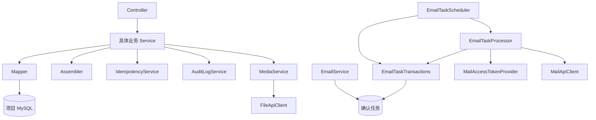

# 十六周年邀请函后端项目文件树与实现说明

版本为 v1.1，更新日期为 2026-11-21。

本文确定后端工程目录、逐文件职责、实现方法与调用链，依据 [需求规格与实现链路](需求规格与实现链路.md)、[数据库设计](数据库设计.md)、[API 接口文档](API接口文档.md)，结合用户提供的 Java Web 模板和去年后端源码编写。

工程根目录为 `16thbirthday/backend/`，根包为 `com.sipc115.birthday`，单模块 Maven 应用。19 个 API 已落地。第 1～13 节保留规划阶段的逐文件职责蓝图；实际实现合并了部分轻量组件，当前目录、合并映射和验收结果见文末“实际实现状态”。

## 1. 工程基线与模板适配

### 1.1 实际读取的模板

模板的 Maven 根目录为 `D:/Users/zhangyue/Desktop/project/java-web-zy-template/template`。

| 项目 | 模板实际声明 | 本项目约定 |
| --- | --- | --- |
| Java | 25 | 按用户决定采用 Java 21 |
| Spring Boot | 4.1.2 | 沿用模板版本，首次构建验证可解析性 |
| 持久层 | MyBatis-Plus 3.5.18 与 MySQL | 保留分页能力，结合绑定参数 XML 完成复杂与并发 SQL |
| Springdoc | 3.2.0 | 依配置启用，代码文档与 API 契约同步 |
| 包组织 | 业务模块内分 controller、service、mapper、entity、request、response、assembler | 按报名、邮件、图片、回忆、荣誉组织 |
| Service | 具体 @Service 类 | 直接实现业务方法，明确事务边界 |
| 请求与响应 | record 与 Bean Validation | 普通请求和响应采用 record，PATCH 等需要记录字段存在性的输入采用 JavaBean |
| 模板认证 | HTTP Basic 与示例权限 | 适配 Keycloak Resource Server 与已确定的 SSO 管理规则 |
| 模板响应 | code、message、data、timestamp、traceId | 适配本项目五字段响应 |
| 模板分页 | list、total、pageNum、pageSize | 适配 content、page、size、totalElements、totalPages |
| 模板主键 | assign_id | 按表分别采用 AUTO 自增和 INPUT UUID |
| 模板删除 | deleted 整数 | 荣誉使用 deleted_at 条件软删除 |
| 模板时间 | LocalDateTime.now() | 使用注入 UTC Clock，API 按 +08:00 输出 |
| 数据库环境 | 示例库与 Compose | 开发本机 MySQL，生产共享业务库 |
| 运行产物 | target/app.jar，Java 25 镜像 | target/app.jar，复制到 Java 21 运行镜像 |

模板版本已核对，项目按用户最新决定使用 Java 21。交付沿用去年先构建 JAR、再通过 Dockerfile 复制到运行镜像的方式。

### 1.2 与去年后端的对应关系

| 去年实现 | 本项目落点 |
| --- | --- |
| Application 启动与 Mapper 扫描 | BirthdayApplication |
| Controller 中的报名、投稿入口 | InvitationController、MemoryController，按 19 接口重新实现 |
| ServiceImpl 的业务处理 | 各模块具体 Service 和独立事务方法 |
| HelixMapper 与 XML | 9 张表各自的实体和 Mapper |
| AsyncService 的异步处理思路 | 已持久化的确认任务、Scheduler、Processor 和短事务服务 |
| COS 工具与图片处理 | MediaService 调用社团 file-api |
| 飞书同步配置与调用 | 当前业务由网页后台、SSO 和社团邮件 API 承担 |
| JAR Dockerfile | 先构建 target/app.jar，再复制到 Java 21 运行镜像 |

### 1.3 Boot 4 相关依赖

在模板基础上补齐 `org.springframework.boot:spring-boot-starter-security-oauth2-resource-server` 和 `org.springframework.boot:spring-boot-starter-restclient`，由同一 Boot 版本管理。Boot 4 的 starter 拆分和 Jackson 3 包名需要按对应版本使用，配置 JsonMapper；Jackson 注解仍使用其注解模块。[Spring Boot 4 迁移说明](https://github.com/spring-projects/spring-boot/wiki/Spring-Boot-4.0-Migration-Guide)

JWT 认证由 Spring Security Resource Server 执行签名、issuer、时间和受众校验，错误输出接入本项目响应。[Spring Security JWT 说明](https://docs.spring.io/spring-security/reference/servlet/oauth2/resource-server/jwt.html)

## 2. 模块边界与依赖



- Controller 负责 HTTP、校验触发和响应状态。
- Service 负责业务规则、幂等、权限上下文和事务。
- Mapper 负责具体数据库操作，复杂查询和条件更新放 XML。
- Entity 对应表字段，Assembler 转换为契约 DTO。
- Client 适配上游协议，Task 处理已确认邮件任务。
- 管理审计与幂等记录在业务事务内提交。
- 外部 HTTP 调用安排在短事务之外。

## 3. 完整文件树

```text
backend/
├── .mvn/
│   └── wrapper/
│       └── maven-wrapper.properties
├── sql/
│   ├── bootstrap/
│   │   └── init.sql
│   ├── schema/
│   │   └── 00_birthday_schema.sql
│   └── README.md
├── src/
│   ├── main/
│   │   ├── java/
│   │   │   └── com/
│   │   │       └── sipc115/
│   │   │           └── birthday/
│   │   │               ├── audit/
│   │   │               │   ├── entity/
│   │   │               │   │   └── AdminOperationLogEntity.java
│   │   │               │   ├── enums/
│   │   │               │   │   └── AdminOperationCode.java
│   │   │               │   ├── mapper/
│   │   │               │   │   └── AdminOperationLogMapper.java
│   │   │               │   └── service/
│   │   │               │       └── AuditLogService.java
│   │   │               ├── common/
│   │   │               │   ├── api/
│   │   │               │   │   ├── ApiErrorWriter.java
│   │   │               │   │   ├── BusinessCode.java
│   │   │               │   │   ├── CommandResult.java
│   │   │               │   │   ├── CommonResponse.java
│   │   │               │   │   ├── ErrorCode.java
│   │   │               │   │   ├── PageResponse.java
│   │   │               │   │   └── TraceId.java
│   │   │               │   ├── exceptions/
│   │   │               │   │   ├── BusinessException.java
│   │   │               │   │   └── GlobalExceptionHandler.java
│   │   │               │   ├── ratelimit/
│   │   │               │   │   └── RateLimitService.java
│   │   │               │   ├── request/
│   │   │               │   │   └── PageQueryRequest.java
│   │   │               │   ├── utils/
│   │   │               │   │   ├── ApiTime.java
│   │   │               │   │   ├── ClientIpResolver.java
│   │   │               │   │   ├── RequestFingerprint.java
│   │   │               │   │   └── RequestValues.java
│   │   │               │   └── validation/
│   │   │               │       ├── CodePointLength.java
│   │   │               │       ├── CodePointLengthValidator.java
│   │   │               │       ├── EnumValue.java
│   │   │               │       └── EnumValueValidator.java
│   │   │               ├── config/
│   │   │               │   ├── AsyncConfig.java
│   │   │               │   ├── BirthdayConfig.java
│   │   │               │   ├── BirthdayProperties.java
│   │   │               │   ├── HttpClientConfig.java
│   │   │               │   ├── JacksonConfig.java
│   │   │               │   ├── MybatisPlusConfig.java
│   │   │               │   ├── OpenApiConfig.java
│   │   │               │   ├── SecurityConfig.java
│   │   │               │   └── WebConfig.java
│   │   │               ├── email/
│   │   │               │   ├── assembler/
│   │   │               │   │   └── EmailAssembler.java
│   │   │               │   ├── client/
│   │   │               │   │   ├── KeycloakTokenClient.java
│   │   │               │   │   ├── MailApiClient.java
│   │   │               │   │   └── MailIntegrationException.java
│   │   │               │   ├── controller/
│   │   │               │   │   └── AdminEmailController.java
│   │   │               │   ├── entity/
│   │   │               │   │   └── EmailNotificationEntity.java
│   │   │               │   ├── enums/
│   │   │               │   │   ├── EmailNotifyStatus.java
│   │   │               │   │   ├── EmailTaskStatus.java
│   │   │               │   │   ├── MailTaskErrorCode.java
│   │   │               │   │   └── RemoteMailStatus.java
│   │   │               │   ├── mapper/
│   │   │               │   │   └── EmailNotificationMapper.java
│   │   │               │   ├── model/
│   │   │               │   │   ├── InvitationMailSnapshot.java
│   │   │               │   │   └── RenderedMail.java
│   │   │               │   ├── request/
│   │   │               │   │   ├── EmailConfirmRequest.java
│   │   │               │   │   └── EmailHistoryRequest.java
│   │   │               │   ├── response/
│   │   │               │   │   ├── EmailPreviewResponse.java
│   │   │               │   │   └── EmailSendResponse.java
│   │   │               │   ├── service/
│   │   │               │   │   ├── EmailService.java
│   │   │               │   │   ├── MailAccessTokenProvider.java
│   │   │               │   │   └── MailTemplateRenderer.java
│   │   │               │   └── task/
│   │   │               │       ├── EmailTaskProcessor.java
│   │   │               │       ├── EmailTaskScheduler.java
│   │   │               │       ├── EmailTaskTransactions.java
│   │   │               │       └── LeasedEmailTask.java
│   │   │               ├── healthcheck/
│   │   │               │   ├── HealthCheckController.java
│   │   │               │   ├── HealthCheckResponse.java
│   │   │               │   └── HealthCheckService.java
│   │   │               ├── honor/
│   │   │               │   ├── assembler/
│   │   │               │   │   └── HonorAssembler.java
│   │   │               │   ├── controller/
│   │   │               │   │   ├── AdminHonorController.java
│   │   │               │   │   └── HonorController.java
│   │   │               │   ├── entity/
│   │   │               │   │   ├── HonorEntryEntity.java
│   │   │               │   │   └── HonorImageEntity.java
│   │   │               │   ├── mapper/
│   │   │               │   │   ├── HonorEntryMapper.java
│   │   │               │   │   └── HonorImageMapper.java
│   │   │               │   ├── request/
│   │   │               │   │   ├── HonorCreateRequest.java
│   │   │               │   │   └── HonorPatchRequest.java
│   │   │               │   ├── response/
│   │   │               │   │   ├── HonorAdminResponse.java
│   │   │               │   │   ├── HonorDeleteResponse.java
│   │   │               │   │   └── HonorResponse.java
│   │   │               │   └── service/
│   │   │               │       └── HonorService.java
│   │   │               ├── idempotency/
│   │   │               │   ├── entity/
│   │   │               │   │   └── IdempotencyRequestEntity.java
│   │   │               │   ├── enums/
│   │   │               │   │   └── IdempotencyState.java
│   │   │               │   ├── mapper/
│   │   │               │   │   └── IdempotencyRequestMapper.java
│   │   │               │   └── service/
│   │   │               │       └── IdempotencyService.java
│   │   │               ├── invitation/
│   │   │               │   ├── assembler/
│   │   │               │   │   └── InvitationAssembler.java
│   │   │               │   ├── controller/
│   │   │               │   │   ├── AdminInvitationController.java
│   │   │               │   │   └── InvitationController.java
│   │   │               │   ├── entity/
│   │   │               │   │   └── InvitationEntity.java
│   │   │               │   ├── enums/
│   │   │               │   │   ├── Attendance.java
│   │   │               │   │   ├── GiftChoice.java
│   │   │               │   │   └── InvitationResult.java
│   │   │               │   ├── export/
│   │   │               │   │   └── InvitationCsvWriter.java
│   │   │               │   ├── mapper/
│   │   │               │   │   ├── InvitationMapper.java
│   │   │               │   │   ├── InvitationStatsRow.java
│   │   │               │   │   └── InvitationSummaryRow.java
│   │   │               │   ├── request/
│   │   │               │   │   ├── InvitationExportRequest.java
│   │   │               │   │   ├── InvitationPageRequest.java
│   │   │               │   │   ├── InvitationPatchRequest.java
│   │   │               │   │   └── InvitationSubmitRequest.java
│   │   │               │   ├── response/
│   │   │               │   │   ├── InvitationResponse.java
│   │   │               │   │   ├── InvitationStatsResponse.java
│   │   │               │   │   └── InvitationSubmitResponse.java
│   │   │               │   ├── service/
│   │   │               │   │   ├── InvitationQueryService.java
│   │   │               │   │   └── InvitationService.java
│   │   │               │   └── validation/
│   │   │               │       └── InvitationValidator.java
│   │   │               ├── media/
│   │   │               │   ├── assembler/
│   │   │               │   │   └── MediaAssembler.java
│   │   │               │   ├── client/
│   │   │               │   │   └── FileApiClient.java
│   │   │               │   ├── controller/
│   │   │               │   │   └── MediaController.java
│   │   │               │   ├── entity/
│   │   │               │   │   └── MediaImageEntity.java
│   │   │               │   ├── enums/
│   │   │               │   │   └── ImageMimeType.java
│   │   │               │   ├── mapper/
│   │   │               │   │   └── MediaImageMapper.java
│   │   │               │   ├── model/
│   │   │               │   │   └── UploadOwner.java
│   │   │               │   ├── response/
│   │   │               │   │   ├── ImageResponse.java
│   │   │               │   │   └── ImageUploadResponse.java
│   │   │               │   ├── service/
│   │   │               │   │   ├── MediaService.java
│   │   │               │   │   └── UploadOwnershipService.java
│   │   │               │   └── validation/
│   │   │               │       └── ImageUploadValidator.java
│   │   │               ├── memory/
│   │   │               │   ├── assembler/
│   │   │               │   │   └── MemoryAssembler.java
│   │   │               │   ├── controller/
│   │   │               │   │   └── MemoryController.java
│   │   │               │   ├── entity/
│   │   │               │   │   ├── MemoryEntity.java
│   │   │               │   │   └── MemoryImageEntity.java
│   │   │               │   ├── mapper/
│   │   │               │   │   ├── MemoryImageMapper.java
│   │   │               │   │   └── MemoryMapper.java
│   │   │               │   ├── request/
│   │   │               │   │   └── MemorySubmitRequest.java
│   │   │               │   ├── response/
│   │   │               │   │   ├── MemoryDetailResponse.java
│   │   │               │   │   └── MemorySummaryResponse.java
│   │   │               │   └── service/
│   │   │               │       └── MemoryService.java
│   │   │               ├── security/
│   │   │               │   ├── CurrentUser.java
│   │   │               │   └── CurrentUserProvider.java
│   │   │               ├── web/
│   │   │               │   ├── filter/
│   │   │               │   │   ├── RequestBodyLimitFilter.java
│   │   │               │   │   └── TraceIdFilter.java
│   │   │               │   └── interceptor/
│   │   │               │       └── RequestContractInterceptor.java
│   │   │               └── BirthdayApplication.java
│   │   └── resources/
│   │       ├── mapper/
│   │       │   ├── AdminOperationLogMapper.xml
│   │       │   ├── EmailNotificationMapper.xml
│   │       │   ├── HonorEntryMapper.xml
│   │       │   ├── HonorImageMapper.xml
│   │       │   ├── IdempotencyRequestMapper.xml
│   │       │   ├── InvitationMapper.xml
│   │       │   ├── MediaImageMapper.xml
│   │       │   ├── MemoryImageMapper.xml
│   │       │   └── MemoryMapper.xml
│   │       ├── templates/
│   │       │   └── mail/
│   │       │       ├── confirmation.html
│   │       │       └── confirmation.txt
│   │       ├── application-dev.yml
│   │       ├── application-prod.yml
│   │       └── application.yml
│   └── test/
│       ├── java/
│       │   └── com/
│       │       └── sipc115/
│       │           └── birthday/
│       │               ├── ApiContractTest.java
│       │               ├── BusinessTransactionIT.java
│       │               └── EmailTaskProcessorTest.java
│       └── resources/
│           └── application-test.yml
├── .dockerignore
├── .env.example
├── .gitignore
├── Dockerfile
├── mvnw
├── mvnw.cmd
├── pom.xml
└── README.md
```

本版列出 155 个计划文件，其中 Java 文件 128 个，包含 3 个验证类。sql/migrations 与 sql/maintenance 目录按实际变更加入顺序脚本；具体变更发生时再确定对应文件。target/app.jar 为构建产物。

## 4. 逐文件职责与具体写法

以下 Java 路径相对于 `src/main/java/com/sipc115/birthday/`，其他路径相对于 backend 根目录。请求和响应字段必须逐项对照 API 文档，实体字段必须逐项对照数据库文档。

### 4.1 构建与交付

| 文件 | 职责 | 具体实现 | 关联 |
| --- | --- | --- | --- |
| `pom.xml` | 单模块 Maven 构建入口。 | 使用 Java 21、Boot 4.1.2、MyBatis-Plus 3.5.18 和 Springdoc 3.2.0；坐标改为 com.sipc115:birthday16-api，finalName=app。补齐 Boot 4 Resource Server、RestClient 依赖，统一版本由模板 BOM 管理。 | target/app.jar |
| `.mvn/wrapper/maven-wrapper.properties` | Maven Wrapper 下载配置。 | 复制模板 wrapper 配置；首次构建核对下载版本可解析。 | mvnw、mvnw.cmd |
| `mvnw` | Unix Maven 入口。 | 复制模板脚本，保留可执行权限。 | pom.xml |
| `mvnw.cmd` | Windows Maven 入口。 | 复制模板脚本，开发统一从 backend 根目录执行。 | pom.xml |
| `Dockerfile` | JAR 应用镜像。 | 使用 Java 21 运行镜像，复制事先构建的 target/app.jar，SERVER_PORT 由环境配置，延续去年的 JAR Dockerfile 交付。 | application-prod.yml |
| `.dockerignore` | 控制镜像构建上下文。 | 排除 .git、target、本地环境文件和临时产物，保留源码、pom 与 wrapper。 | 工程配置 |
| `.gitignore` | 版本库忽略规则。 | 忽略 target、日志和真实 .env，保留 .env.example。 | 工程配置 |
| `.env.example` | 部署和本机配置字段样例。 | 仅列占位符，包含 DB、Keycloak、邮件客户端、图片服务、限流、任务租约、环境标识和端口。 | BirthdayProperties |
| `README.md` | 项目启动与交付入口。 | 写明 JDK、wrapper、配置加载、本机数据库初始化、测试和镜像命令，并链接工作区现有需求、API、数据库和结构文档。 | sql/README.md、Dockerfile |

### 4.2 SQL 与资源

| 文件 | 职责 | 具体实现 | 关联 |
| --- | --- | --- | --- |
| `sql/README.md` | SQL 使用说明。 | 区分完整 schema、新库初始化、增量变更和维护脚本；注明执行目录、目标库检查及迁移记录。 | 工程配置 |
| `sql/schema/00_birthday_schema.sql` | 9 张表的完整基线。 | 从数据库设计提取已验证 DDL，包含 100 个字段、5 个外键和生成列唯一约束，维护单一基线。 | 数据库设计.md |
| `sql/bootstrap/init.sql` | 本机新开发库初始化入口。 | 明确作用于生日开发库，在 backend 根目录通过 MySQL 客户端读取 schema 脚本，数据库名和账号按本机授权落实。 | sql/schema/00_birthday_schema.sql |
| `src/main/resources/application.yml` | 公共配置。 | 配置应用名、/api/v1 路径策略、UTF-8、严格 JSON、上传上限、Mapper XML、日志 MDC 和 app 属性。SQL 初始化采用显式脚本，任务在数据库结构就绪后启用。 | BirthdayProperties |
| `src/main/resources/application-dev.yml` | 本机开发配置。 | 连接本机 MySQL 的独立库；图片、邮件和 SSO 使用已有云端服务，保留 5173 的本地来源，真实凭证从环境读入。 | BirthdayProperties |
| `src/main/resources/application-prod.yml` | 生产配置。 | DB 指向共享 MySQL 的独立库；数据库、密钥、正式来源、端口和任务环境名由部署环境注入，日志使用 info。 | BirthdayProperties |
| `src/main/resources/templates/mail/confirmation.txt` | 纯文本确认邮件模板。 | 使用明确占位符渲染姓名、到场、礼物和回执编号，保持 UTF-8；参与预览摘要。 | MailTemplateRenderer |
| `src/main/resources/templates/mail/confirmation.html` | HTML 确认邮件模板。 | 与文本语义一致，替换动态内容前进行 HTML 转义，模板版本与内容进入 previewHash。 | MailTemplateRenderer |
| `src/main/resources/mapper/InvitationMapper.xml` | 业务 SQL。 | 实现手机号或编号锁、版本条件更正、稳定分页、带最新邮件摘要的导出和 12 项统计计数，使用绑定参数。 | InvitationMapper.java |
| `src/main/resources/mapper/EmailNotificationMapper.xml` | 业务 SQL。 | 实现确认键与批次唯一处理、当前版本查询、FOR UPDATE SKIP LOCKED 领取，以及按 leaseToken 更新状态，所有写列排除 active_marker。 | EmailNotificationMapper.java |
| `src/main/resources/mapper/MediaImageMapper.xml` | 业务 SQL。 | 实现图片登记、按 UUID 批量读取和有序行锁；所有图片归属判断在服务中使用查询结果。 | MediaImageMapper.java |
| `src/main/resources/mapper/MemoryMapper.xml` | 业务 SQL。 | 实现 submissionId 去重读取、插入和 published_at/id 分页。 | MemoryMapper.java |
| `src/main/resources/mapper/MemoryImageMapper.xml` | 业务 SQL。 | 实现复合键关联批量插入、认领查找与有序批量查询。 | MemoryImageMapper.java |
| `src/main/resources/mapper/HonorEntryMapper.xml` | 业务 SQL。 | 实现 deleted_at IS NULL 查询，版本条件编辑和软删除，AUTO 主键通过 JDBC 回填。 | HonorEntryMapper.java |
| `src/main/resources/mapper/HonorImageMapper.xml` | 业务 SQL。 | 实现复合键批量写入、有序读取及按 honorId 删除旧关联，和主表同事务。 | HonorImageMapper.java |
| `src/main/resources/mapper/AdminOperationLogMapper.xml` | 业务 SQL。 | 将管理动作和合法 JSON 摘要写入日志表。 | AdminOperationLogMapper.java |
| `src/main/resources/mapper/IdempotencyRequestMapper.xml` | 业务 SQL。 | 按命令类型、用户和请求编号查询，创建事务内占位和保存完成响应。 | IdempotencyRequestMapper.java |

### 4.3 启动与配置

| 文件 | 职责 | 具体实现 | 关联 |
| --- | --- | --- | --- |
| `BirthdayApplication.java` | 应用入口。 | 放在根包，启动 Spring Boot，扫描各模块 Mapper，启用配置属性和邮件任务调度。 | 全部模块 |
| `config/BirthdayProperties.java` | 集中读取 app 配置。 | 以 @ConfigurationProperties 和嵌套 record 表达 Security、Cors、Mail、File、Limits、Tasks；校验启用邮件时所需凭证、超时与租约范围。 | application*.yml |
| `config/BirthdayConfig.java` | 公共运行时 Bean。 | 注册 Clock.systemUTC()、配置属性和 TransactionTemplate，时间与事务入口可注入测试。 | ApiTime、写服务 |
| `config/SecurityConfig.java` | SSO 资源服务器认证。 | 启用 JWT Resource Server，验证 issuer、期限、配置 audience；/api/v1/admin/** 要求用户认证，公开路由允许匿名；提供了无效 Bearer 时按 401 处理，委托 ApiErrorWriter 输出。 | CurrentUserProvider、ApiErrorWriter |
| `config/WebConfig.java` | MVC、CORS 与拦截器。 | 注册 RequestContractInterceptor；来源从配置读取，支持 Cookie，暴露 X-Request-ID、Idempotency-Replayed、Retry-After、Content-Disposition。 | RequestContractInterceptor |
| `config/JacksonConfig.java` | 严格 JSON 绑定。 | 使用 Boot 4 管理的 JsonMapper 定制未知或忽略字段、标量强转和重复键处理；数字不能转字符串，显式 null 与省略按请求类型区分，保留响应 null。 | 请求 DTO、CommonResponse |
| `config/MybatisPlusConfig.java` | MySQL 分页与字段策略。 | 启用分页插件；按实体配置 AUTO 或 INPUT 主键；实体字段对应当前表结构，审计时间用 UTC，业务 version 和软删除由条件 SQL 显式维护。 | 实体与 Mapper |
| `config/HttpClientConfig.java` | 上游 HTTP 客户端。 | 使用 Boot 4 RestClient 支持及有名 Bean 区分 Keycloak、mail-api、file-api；配置超时、响应大小和仅元数据日志，按服务处理 JSON 与 multipart。 | 三个外部 Client |
| `config/AsyncConfig.java` | 有界任务执行器。 | 沿用线程池配置思路，为邮件工作器配置有限并发与队列，复制必要 MDC，配合租约安排领取容量，避免先大量认领后排队过期。 | EmailTaskScheduler |
| `config/OpenApiConfig.java` | 代码生成 OpenAPI 的公共元数据。 | 标题与版本使用生日项目值，声明 Bearer、安全要求、统一封装和字符串编号，按配置开关开放开发文档。 | 19 个路由 |

### 4.4 公共契约

| 文件 | 职责 | 具体实现 | 关联 |
| --- | --- | --- | --- |
| `common/api/CommonResponse.java` | 统一 JSON 响应。 | record 字段固定为 code、message、data、fieldErrors、traceId，提供成功、失败和 CommandResult 到 ResponseEntity 的工厂，CSV 成功由 Controller 单独输出。 | API 第 2～4 节 |
| `common/api/PageResponse.java` | 统一分页结果。 | record 固定 content、page、size、totalElements、totalPages，把 MyBatis-Plus Page 转换为 API Page，页码从 1 开始。 | API 第 2～4 节 |
| `common/api/BusinessCode.java` | 11 个成功业务码。 | 逐项实现 API 成功码及 HTTP 状态，不把所有成功强制改成同一 HTTP 200。 | API 第 2～4 节 |
| `common/api/ErrorCode.java` | 33 个 HTTP 错误码。 | 按 API 文档逐项定义 code、默认中文提示与 HttpStatus。 | API 第 2～4 节 |
| `common/api/TraceId.java` | 请求追踪常量和读取。 | 统一常量 X-Request-ID，读取 MDC，使用带连字符 UUID v4。 | API 第 2～4 节 |
| `common/api/ApiErrorWriter.java` | 过滤器和认证错误输出。 | 从同一个 JSON mapper 序列化 CommonResponse，处理 MVC 之前的错误，保持五字段和响应头一致。 | API 第 2～4 节 |
| `common/api/CommandResult.java` | 幂等命令的业务返回。 | record 保存 HTTP 状态、BusinessCode、data 和 replayed，Controller 生成本次 traceId 与 Idempotency-Replayed 头。 | API 第 2～4 节 |
| `common/exceptions/BusinessException.java` | 可展示的业务错误。 | 携带 ErrorCode、message、fieldErrors 和内部 cause，提供按字段构造的入口。 | ErrorCode |
| `common/exceptions/GlobalExceptionHandler.java` | 全局异常归一化。 | 覆盖验证、JSON 类型、未知字段、参数、资源、方法、Accept、Content-Type、上传、数据库和兜底异常；将字段路径归到 fieldErrors，保留 traceId。 | ApiErrorWriter |
| `common/validation/CodePointLength.java` | Unicode 码点长度注解。 | 定义 min、max、message，支持字段、参数与 record component；必填性由 @NotBlank 或业务规则执行。 | 请求 DTO |
| `common/validation/CodePointLengthValidator.java` | 码点长度验证器。 | 对非 null 字符串使用 codePointCount 校验，避免 @Size 按 UTF-16 统计导致中文扩展字符或 emoji 长度偏差。 | 请求 DTO |
| `common/validation/EnumValue.java` | 枚举值验证注解。 | 沿用模板注解语义，严格大小写，指向本包 EnumValueValidator。 | 请求 DTO |
| `common/validation/EnumValueValidator.java` | 枚举值验证器。 | 使用 ConstraintValidator 比较枚举 name，null 交给必填规则；验证失败归为 VALIDATION_ERROR。 | 请求 DTO |
| `common/utils/RequestValues.java` | 请求值归一化和编号规则。 | 提供 trimToNull、requiredText、parseId、parseVersion 与 UUID_V4 正则常量，严格限制 int64 字符串范围。 | 请求校验与业务服务 |
| `common/utils/RequestFingerprint.java` | 稳定请求和预览摘要。 | 对规范化字段按稳定键序生成 SHA-256，保留数组顺序；可接收路径、版本、模板标识及邮件正文，避免使用原始 JSON 字节作为语义摘要。 | 请求校验与业务服务 |
| `common/utils/ApiTime.java` | UTC 与 API 时间转换。 | 使用注入 Clock 获取 UTC LocalDateTime，把数据库和上游时间转换为 API 固定毫秒、+08:00 字符串。 | 请求校验与业务服务 |
| `common/utils/ClientIpResolver.java` | 受控客户端 IP 解析。 | 默认使用 remoteAddr，仅信任配置的代理链，以实际 IP 生成限流键，避免客户端随意提供转发头。 | 请求校验与业务服务 |
| `common/request/PageQueryRequest.java` | 通用分页输入。 | JavaBean 默认 page=1、size=20，校验正整数；公开接口调用统一上限校验 50，后台上限 100，超限返回字段错误。 | 列表 Controller |
| `common/ratelimit/RateLimitService.java` | 应用层固定窗口限流。 | 按 API 配置的 IP 或 sub 和路由维护计数，原子判断并返回 Retry-After，定期清理过期窗口；多副本部署时对齐网关共享限流。 | RequestContractInterceptor |

### 4.5 Web 与身份

| 文件 | 职责 | 具体实现 | 关联 |
| --- | --- | --- | --- |
| `web/filter/TraceIdFilter.java` | 最早建立请求追踪。 | 在 Security 之前建立 UUID、响应头与 MDC，finally 清理；过滤器、Controller 和日志共享当前编号。 | TraceId |
| `web/filter/RequestBodyLimitFilter.java` | 整体请求体上限。 | JSON 使用长度检查和实际流读取上限 1 MiB；multipart 结合 Servlet 容器的 10 MiB 单文件、11 MiB 总请求限制，错误委托 ApiErrorWriter。 | ApiErrorWriter |
| `web/interceptor/RequestContractInterceptor.java` | 参数契约与限流入口。 | 根据 HandlerMethod 的 RequestParam 或 ModelAttribute 字段确定允许 query；拒绝重复、未知、空数字和额外 body；校验路径 id，调用 RateLimitService。 | PageQueryRequest、ClientIpResolver |
| `security/CurrentUser.java` | 已验证用户摘要。 | record 只保存 sub、可空用户名或显示名，由后端认证上下文构造。 | CurrentUserProvider |
| `security/CurrentUserProvider.java` | 取得当前管理或上传身份。 | 从 JwtAuthenticationToken 提供 required() 与 optional()，禁止从请求体读取操作人。 | SecurityConfig、审计与上传 |

### 4.6 管理记录与幂等

| 文件 | 职责 | 具体实现 | 关联 |
| --- | --- | --- | --- |
| `audit/entity/AdminOperationLogEntity.java` | admin_operation_logs 映射。 | 按表字段声明 Long id、身份、动作、目标、trace 和 String changesJson，时间为 UTC。 | AdminOperationLogMapper |
| `audit/mapper/AdminOperationLogMapper.java` | 管理记录写入接口。 | 提供 insert 成功操作，JSON 参数以合法文本写入 MySQL JSON。 | AdminOperationLogMapper.xml |
| `audit/service/AuditLogService.java` | 同事务操作留痕。 | record(action,target,changes) 从身份上下文和 MDC 取得元数据，以 MANDATORY 加入业务事务。 | 业务写服务 |
| `audit/enums/AdminOperationCode.java` | 5 类管理动作。 | 实现 INVITATION_UPDATE、EMAIL_CONFIRM、HONOR_CREATE、HONOR_UPDATE、HONOR_DELETE，与 API 字典一致。 | 审计、幂等 |
| `idempotency/entity/IdempotencyRequestEntity.java` | idempotency_requests 映射。 | 保存范围、用户、请求编号、摘要、状态、目标、HTTP 结果和 String responseBodyJson。 | IdempotencyRequestMapper |
| `idempotency/mapper/IdempotencyRequestMapper.java` | 命令占位与结果查询。 | 按 operationCode、actorSub、requestId 查询或插入，成功后同事务写完成状态和响应快照。 | IdempotencyRequestMapper.xml |
| `idempotency/service/IdempotencyService.java` | 管理命令幂等执行。 | execute 加入调用方事务，唯一键插入竞争后使用锁定读取得当前已提交结果；摘要一致重放，差异 409，回调失败整体回滚。 | CommandResult、RequestFingerprint |
| `idempotency/enums/IdempotencyState.java` | 幂等状态。 | 定义 PROCESSING、COMPLETED，和数据库约束一致。 | IdempotencyRequestEntity |

### 4.7 报名模块

| 文件 | 职责 | 具体实现 | 关联 |
| --- | --- | --- | --- |
| `invitation/controller/InvitationController.java` | 公开回执入口。 | 仅处理 POST、校验、业务调用和动态 201/200 响应，委托 InvitationService.submit。 | 19 接口映射 |
| `invitation/controller/AdminInvitationController.java` | 后台报名入口。 | 提供分页、统计、CSV、更正；CSV 成功写文件头与流，错误保持统一 JSON。 | 19 接口映射 |
| `invitation/entity/InvitationEntity.java` | invitations 映射。 | Long AUTO 主键和 version，保存严格手机号、枚举代码、地址和 UTC 时间。 | InvitationMapper |
| `invitation/mapper/InvitationMapper.java` | 回执读写与聚合查询。 | 声明手机号、编号锁定、创建、条件更新、分页行、统计行和导出查询，复杂 SQL 放 XML。 | InvitationMapper.xml |
| `invitation/mapper/InvitationSummaryRow.java` | 回执加当前邮件状态的查询行。 | 可映射 JavaBean 保存 Long 编号版本和 UTC 时间，以及当前邮件状态，交给 Assembler 转输出。 | InvitationAssembler |
| `invitation/mapper/InvitationStatsRow.java` | 统计 SQL 行。 | 保存 total、到场、礼物、邮件和地址的计数，查询一次组装为嵌套统计对象。 | InvitationStatsResponse |
| `invitation/service/InvitationService.java` | 回执提交和更正。 | submit 使用明确事务边界处理唯一手机号竞争，变化才增版本；update 校验 expectedVersion、幂等与审计，保存回执后返回。 | InvitationValidator、InvitationMapper |
| `invitation/service/InvitationQueryService.java` | 后台读取。 | page、stats、export 使用同一筛选与当前版本邮件推导；导出按稳定排序分批读取。 | InvitationMapper、InvitationAssembler |
| `invitation/validation/InvitationValidator.java` | 回执跨字段规则。 | 校验手机号、到场礼物组合及地址，合并 PATCH 后再检查，非邮寄省略地址时清空旧值。 | InvitationService |
| `invitation/export/InvitationCsvWriter.java` | 固定列 CSV 写入。 | 使用 API 固定列顺序、UTF-8 BOM、正确转义及单元格文本处理，写入前完成可预测的请求校验。 | InvitationQueryService |
| `invitation/request/InvitationSubmitRequest.java` | 公开回执请求，手机号用于识别同一报名人。 | 字段为 name、phone、email、attendance、giftChoice、mailingAddress。按 API 契约设置必填、空值、枚举和长度。采用 record，构造时规范化文本，字符串枚举经验证后转领域枚举。 | API 对象 InvitationSubmitRequest |
| `invitation/request/InvitationPatchRequest.java` | 至少提交一个可编辑业务字段。 | 字段为 requestId、expectedVersion、name、email、attendance、giftChoice、mailingAddress。按 API 契约设置必填、空值、枚举和长度。采用 JavaBean 与显式 setter 记录字段是否提供，区分省略、null 和清空；providedFields 属于内部状态。 | API 对象 InvitationPatchRequest |
| `invitation/request/InvitationPageRequest.java` | 报名查询输入。 | 字段 attendance、giftChoice、keyword、page、size，默认 1/20，最大 100，关键词最多 100 码点。 | AdminInvitationController |
| `invitation/request/InvitationExportRequest.java` | CSV 筛选输入。 | 字段 attendance、giftChoice、keyword，采用与分页相同的筛选校验。 | InvitationQueryService |
| `invitation/response/InvitationSubmitResponse.java` | 回执保存结果。 | 字段为 id、result、submittedAt。按 API 契约设置必填、空值、枚举和长度。 | API 对象 InvitationSubmitData |
| `invitation/response/InvitationResponse.java` | 后台完整回执。邮件字段按当前业务版本的最新批次推导。 | 字段为 id、name、phone、email、attendance、giftChoice、mailingAddress、version、emailNotifyStatus、emailNotifiedAt、createdAt、updatedAt。按 API 契约设置必填、空值、枚举和长度。编号和版本均为 String，计数和时间按公共转换规则。 | API 对象 InvitationRecord |
| `invitation/response/InvitationStatsResponse.java` | 全量报名统计。 | 字段为 total、attendance、gifts、email、mailingAddressCount。按 API 契约设置必填、空值、枚举和长度。AttendanceStats、GiftStats、EmailStats 作为本文件内 public record 声明，字段逐项对照 API。 | API 对象 InvitationStats |
| `invitation/assembler/InvitationAssembler.java` | 回执和统计转换。 | 将 Entity、查询行和统计行转换为 API 响应，集中完成编号字符串、时间与邮件状态映射。 | 三种 Invitation 响应 |
| `invitation/enums/Attendance.java` | 报名枚举。 | 定义 ATTENDING、NOT_ATTENDING，提供 CSV 和模板所需中文标签。 | 邀请回执 |
| `invitation/enums/GiftChoice.java` | 报名枚举。 | 定义 NONE、PICKUP、MAIL，提供 CSV 和模板所需中文标签。 | 邀请回执 |
| `invitation/enums/InvitationResult.java` | 报名枚举。 | 定义 CREATED、UPDATED，提供 CSV 和模板所需中文标签。 | 邀请回执 |

### 4.8 邮件模块

| 文件 | 职责 | 具体实现 | 关联 |
| --- | --- | --- | --- |
| `email/controller/AdminEmailController.java` | 预览、确认与历史入口。 | 调用 EmailService，预览返回摘要，确认区分 202、新任务复用 200 与禁用结果，历史分页返回已有缓存状态。 | 19 接口映射 |
| `email/entity/EmailNotificationEntity.java` | email_notifications 映射。 | 完整映射 34 字段，快照 JSON 用 String 显式编解码；activeMarker 仅只读，插入和更新 SQL 排除生成列。 | EmailNotificationMapper |
| `email/mapper/EmailNotificationMapper.java` | 批次与任务状态持久化。 | 提供确认去重、活动批次、批次递增、历史分页、到期领取和带 leaseToken 的状态更新。 | EmailNotificationMapper.xml |
| `email/service/EmailService.java` | 预览、确认、历史业务。 | preview 渲染并取摘要；confirm 事务锁回执、校验版本和预览、确认键与活动槽位，保存快照和审计；history 读取已保存状态。 | MailTemplateRenderer、EmailNotificationMapper |
| `email/service/MailTemplateRenderer.java` | 确认内容渲染。 | 加载两个 UTF-8 模板，对替换值转义，冻结主题、文本、HTML 与模板版本，计算 previewHash。 | RenderedMail、RequestFingerprint |
| `email/service/MailAccessTokenProvider.java` | 邮件服务凭证缓存。 | 按 expires_in 缓存 client_credentials 访问令牌，临近过期单次刷新；401 可失效缓存并刷新一次。 | KeycloakTokenClient |
| `email/client/KeycloakTokenClient.java` | 获取邮件服务账号令牌。 | 以 form POST token endpoint，字段 grant_type、client_id、client_secret，解析 token 与 expires_in，响应 DTO 作为私有 record。 | HttpClientConfig、MailAccessTokenProvider |
| `email/client/MailApiClient.java` | 社团邮件 API 适配。 | submit 和 getStatus 使用 Bearer；区分 200 幂等与 202，读取 data.id、data.mail 和日志摘要，内部 record 使用上游 snake_case 映射。 | MailIntegrationException |
| `email/client/MailIntegrationException.java` | 携带上游失败语义。 | 记录 MailTaskErrorCode、是否可重试、是否可能已受理及脱敏原因，供 Processor 决定状态。 | EmailTaskProcessor |
| `email/model/RenderedMail.java` | 预览和冻结的渲染结果。 | record 包含收件邮箱、主题、文本、HTML、模板版本和 previewHash。 | MailTemplateRenderer |
| `email/model/InvitationMailSnapshot.java` | 已确认的回执快照。 | record 保存回执版本和规范化业务字段，以及 mailTemplateVersion、mailPreviewHash，显式转为 JSON 保存。 | EmailNotificationEntity |
| `email/request/EmailConfirmRequest.java` | 管理员二次确认发送。 | 字段为 requestId、expectedVersion、previewHash。按 API 契约设置必填、空值、枚举和长度。 | API 对象 EmailConfirmRequest |
| `email/request/EmailHistoryRequest.java` | 历史分页输入。 | 字段 invitationVersion、page、size，版本可省略，默认 1/20，最大 100。 | AdminEmailController |
| `email/response/EmailPreviewResponse.java` | 仅生成预览，读取不创建发送任务。 | 字段为 invitationId、invitationVersion、recipientEmail、subject、textBody、htmlBody、previewHash、emailEnabled。按 API 契约设置必填、空值、枚举和长度。 | API 对象 EmailPreviewData |
| `email/response/EmailSendResponse.java` | 本项目邮件批次与状态摘要，状态来自后端已保存的中台查询结果。 | 字段为 id、invitationId、invitationVersion、sendNo、requestId、recipientEmail、subject、textBody、htmlBody、emailNotifyStatus、taskStatus、remoteMailId、remoteStatus、confirmedBySub、confirmedByName、confirmedAt、acceptedAt、sentAt、submitAttempts、smtpAttempts、nextCheckAt、lastErrorCode、lastErrorMessage、createdAt、updatedAt。按 API 契约设置必填、空值、枚举和长度。 | API 对象 EmailSendItem |
| `email/assembler/EmailAssembler.java` | 邮件状态输出转换。 | 统一任务状态到 EmailNotifyStatus 的映射，将 remoteAttempts 转 smtpAttempts，nextRunAt 转 nextCheckAt，时间和编号按 API 规则输出。 | EmailSendResponse |
| `email/enums/EmailNotifyStatus.java` | 邮件枚举。 | 逐项定义 NOT_SENT、PENDING、SUCCESS、FAILED、DISABLED，区分任务、外部状态和业务摘要。 | API 与状态机 |
| `email/enums/EmailTaskStatus.java` | 邮件枚举。 | 逐项定义 READY、SUBMITTING、SUBMIT_RETRY、SUBMIT_UNKNOWN、POLLING、SUCCEEDED、FAILED、CANCELLED、DISABLED，区分任务、外部状态和业务摘要。 | API 与状态机 |
| `email/enums/RemoteMailStatus.java` | 邮件枚举。 | 逐项定义 queued、sending、sent、failed，区分任务、外部状态和业务摘要。 | API 与状态机 |
| `email/enums/MailTaskErrorCode.java` | 邮件枚举。 | 逐项定义 API 中 13 个 MAIL_* 任务错误码，区分任务、外部状态和业务摘要。 | API 与状态机 |
| `email/task/EmailTaskScheduler.java` | 定时领取任务。 | 按线程池可执行容量领取到期任务并提交；拒绝执行时释放或安排恢复，后台调用 EmailTaskTransactions。 | AsyncConfig |
| `email/task/EmailTaskProcessor.java` | 外部调用和状态机推进。 | 根据已领取状态提交或查询，处理 13 类任务错误、版本过时、不确定受理与稳定 client_key，HTTP 调用在事务外。 | MailApiClient、MailAccessTokenProvider |
| `email/task/EmailTaskTransactions.java` | 任务短事务边界。 | public 事务方法执行 claim、accepted、retry、remoteResult、complete；用 leaseToken 条件回写并在终态释放活动标记。 | EmailNotificationMapper |
| `email/task/LeasedEmailTask.java` | 工作器领取快照。 | record 提供通知编号、leaseToken、回执版本、冻结 payload 与已知外部状态，线程间按不可变值传递。 | Scheduler、Processor |

### 4.9 图片模块

| 文件 | 职责 | 具体实现 | 关联 |
| --- | --- | --- | --- |
| `media/controller/MediaController.java` | 单图上传入口。 | 接受唯一 MultipartFile file，取得登录或匿名上传身份，调用 MediaService 返回 201。 | 19 接口映射 |
| `media/entity/MediaImageEntity.java` | media_images 映射。 | 主键为服务端 UUID，IdType.INPUT；保存 URL、输入文件元数据、可用尺寸和上传身份摘要。 | MediaImageMapper |
| `media/mapper/MediaImageMapper.java` | 图片写入、批量读取和锁定。 | 提供按 UUID 批量查询、按稳定顺序 FOR UPDATE，支持保存事务中的图片归属校验。 | MediaImageMapper.xml |
| `media/service/MediaService.java` | 上传和关联校验。 | upload 先校验再调用中台，成功后登记图片；lockAndValidateForAttach 批量校验归属和已有引用，供回忆、荣誉事务调用。 | FileApiClient、MediaImageMapper |
| `media/service/UploadOwnershipService.java` | 上传会话与关联身份。 | 读取或生成 HttpOnly 匿名 Cookie，仅保存 SHA-256；登录上传记录 sub；按当前身份或匿名凭据判定新增关联资格。 | UploadOwner、CurrentUserProvider |
| `media/model/UploadOwner.java` | 上传者值对象。 | record 保存可空 sub 和匿名会话摘要，作为 MediaService 的内部参数。 | UploadOwnershipService |
| `media/client/FileApiClient.java` | 图片中台适配。 | multipart 字段 file，解析 success、url、原名与重命名；把输入、认证、响应格式和超时失败转为 API 图片错误码。 | HttpClientConfig |
| `media/validation/ImageUploadValidator.java` | 本地文件边界校验。 | 校验空文件、10 MiB 和真实文件头；安全解析可用元数据，WebP 等格式的像素和损坏校验结合上游，禁止因 JDK 默认解码器缺失误拒合法格式。 | FileApiClient |
| `media/response/ImageResponse.java` | 公开图片对象。 | 字段为 id、url、width、height。按 API 契约设置必填、空值、枚举和长度。 | API 对象 Image |
| `media/response/ImageUploadResponse.java` | 单张上传结果，所有键始终返回。 | 字段为 id、url、width、height、originalName、sourceMimeType、sourceSizeBytes。按 API 契约设置必填、空值、枚举和长度。 | API 对象 ImageUploadData |
| `media/assembler/MediaAssembler.java` | 图片响应组装。 | 将实体转换为图片和上传响应，未知宽高保持 null，提供批量编号到图片响应映射。 | MemoryAssembler、HonorAssembler |
| `media/enums/ImageMimeType.java` | 图片允许类型。 | 定义 image/jpeg、image/png、image/webp、image/gif 的固定协议值。 | ImageUploadValidator |

### 4.10 回忆模块

| 文件 | 职责 | 具体实现 | 关联 |
| --- | --- | --- | --- |
| `memory/controller/MemoryController.java` | 投稿、列表与详情。 | 公开路由分别调用 publish、page 和 detail，上传结果按有序图片编号提交。 | 19 接口映射 |
| `memory/entity/MemoryEntity.java` | memories 映射。 | AUTO 编号，submissionId、摘要、可空姓名标题正文和 publishedAt，按实际字段独立声明。 | MemoryMapper |
| `memory/entity/MemoryImageEntity.java` | memory_images 映射。 | 声明 memoryId、imageId、position 复合键字段。 | MemoryImageMapper |
| `memory/mapper/MemoryMapper.java` | 投稿持久化。 | 按 submissionId 读取、插入投稿、分页及详情，唯一竞争在事务边界外重读原结果。 | MemoryMapper.xml |
| `memory/mapper/MemoryImageMapper.java` | 有序图片关联。 | 普通 MyBatis Mapper，提供批量插入、按本页 memoryIds 读取和图片认领查询，按复合键操作。 | MemoryImageMapper.xml |
| `memory/service/MemoryService.java` | 完整投稿事务。 | 规范化并判断正文或图片至少一项，校验 UUID 去重、数量、归属和认领，事务保存主表与关联；重复提交比较摘要并复用。 | TransactionTemplate、MediaService |
| `memory/request/MemorySubmitRequest.java` | 姓名和标题可选，正文或图片至少一项。 | 字段为 submissionId、displayName、title、content、imageIds。按 API 契约设置必填、空值、枚举和长度。使用 JavaBean，imageIds 初始为 []，显式 null 按字段错误处理；可选文本规范为 null。 | API 对象 MemorySubmitRequest |
| `memory/response/MemorySummaryResponse.java` | 回忆列表条目。 | 字段为 id、displayName、title、excerpt、coverImage、imageCount、publishedAt。按 API 契约设置必填、空值、枚举和长度。 | API 对象 MemoryListItem |
| `memory/response/MemoryDetailResponse.java` | 完整公开投稿，创建成功也返回此对象。 | 字段为 id、displayName、title、content、images、publishedAt。按 API 契约设置必填、空值、枚举和长度。 | API 对象 MemoryDetail |
| `memory/assembler/MemoryAssembler.java` | 回忆列表和详情组装。 | 列表提取前 120 码点摘要和首图，详情返回完整文字和顺序图片；姓名空值交给前端匿名显示。 | MediaAssembler |

### 4.11 荣誉模块

| 文件 | 职责 | 具体实现 | 关联 |
| --- | --- | --- | --- |
| `honor/controller/HonorController.java` | 公开荣誉列表。 | 读取有效条目并批量组装图片，公开分页最大 50。 | 19 接口映射 |
| `honor/controller/AdminHonorController.java` | 荣誉维护。 | 提供后台分页、编辑读取、创建、PATCH、DELETE，删除参数为 query 的 requestId 与 expectedVersion。 | 19 接口映射 |
| `honor/entity/HonorEntryEntity.java` | honor_entries 映射。 | 保存 title、people、version、身份和 UTC 时间及 deletedAt，业务仅三个表单字段中的标题和人员直接存主表。 | HonorEntryMapper |
| `honor/entity/HonorImageEntity.java` | honor_images 映射。 | 声明 honorId、imageId、position 复合键字段。 | HonorImageMapper |
| `honor/mapper/HonorEntryMapper.java` | 荣誉主表读写。 | 声明有效记录分页、详情、锁定、插入、版本条件编辑和软删除，操作条件通过 XML 明确。 | HonorEntryMapper.xml |
| `honor/mapper/HonorImageMapper.java` | 荣誉图片顺序。 | 普通 Mapper 按复合键处理关联，提供本页批量读取、父记录关联替换及插入。 | HonorImageMapper.xml |
| `honor/service/HonorService.java` | 荣誉完整业务。 | title、people 必填，图组 1～9 张；事务锁父记录和图片、处理幂等与版本、保存关联和日志，查询时批量组装。 | MediaService、IdempotencyService、AuditLogService |
| `honor/request/HonorCreateRequest.java` | 荣誉创建表单。 | 字段为 requestId、title、people、imageIds。按 API 契约设置必填、空值、枚举和长度。 | API 对象 HonorCreateRequest |
| `honor/request/HonorPatchRequest.java` | 至少提供 title、people、imageIds 中一项。 | 字段为 requestId、expectedVersion、title、people、imageIds。按 API 契约设置必填、空值、枚举和长度。使用 JavaBean 与 providedFields 区分未提供、显式 null 和完整图组替换。 | API 对象 HonorPatchRequest |
| `honor/response/HonorResponse.java` | 公开荣誉，仅标题、图片、人员三个业务字段。 | 字段为 id、title、people、images。按 API 契约设置必填、空值、枚举和长度。 | API 对象 HonorItem |
| `honor/response/HonorAdminResponse.java` | 后台荣誉条目。 | 字段为 id、title、people、images、version、createdAt、updatedAt。按 API 契约设置必填、空值、枚举和长度。 | API 对象 HonorAdminItem |
| `honor/response/HonorDeleteResponse.java` | 删除结果。 | 字段为 id、deleted、version、deletedAt。按 API 契约设置必填、空值、枚举和长度。 | API 对象 HonorDeleteData |
| `honor/assembler/HonorAssembler.java` | 荣誉组装。 | 按 position 组装 images，公开只输出标题、人员和图片及编号，后台增加版本和时间。 | MediaAssembler |

### 4.12 健康检查

| 文件 | 职责 | 具体实现 | 关联 |
| --- | --- | --- | --- |
| `healthcheck/HealthCheckController.java` | 应用检查入口。 | 提供 /api/v1/health，按可用状态返回统一响应。 | 19 接口映射 |
| `healthcheck/HealthCheckService.java` | 应用状态。 | 依据应用就绪状态返回 UP 或 DOWN，DOWN 使用 SERVICE_UNAVAILABLE；邮件实际状态由对应任务说明。 | HealthCheckResponse |
| `healthcheck/HealthCheckResponse.java` | 应用运行状态。 | 字段为 status。按 API 契约设置必填、空值、枚举和长度。 | API 对象 HealthData |

### 4.13 验证

| 文件 | 职责 | 具体实现 | 关联 |
| --- | --- | --- | --- |
| `src/test/java/com/sipc115/birthday/ApiContractTest.java` | HTTP 契约与认证回归。 | 使用 MVC、模拟 JwtDecoder 和业务依赖验证 19 个路由、五字段响应、字符串编号、33 错误码与分页，并验证 SSO 成功和 401。 | API 验收场景 |
| `src/test/java/com/sipc115/birthday/BusinessTransactionIT.java` | 本机数据库集成回归。 | 在显式本机测试库验证手机号唯一、回忆原子发布、1～9 张荣誉图、人员文本、版本冲突、幂等、同版本活动批次和软删除。 | API 验收场景 |
| `src/test/java/com/sipc115/birthday/EmailTaskProcessorTest.java` | 异步任务回归。 | 使用假的 Client 和 Clock 覆盖未知受理、原键重试、旧版本处理、租约过期、迟到工作器回写和 SMTP 状态映射。 | API 验收场景 |
| `src/test/resources/application-test.yml` | 显式测试环境。 | 使用本机独立测试库环境变量，任务与上游访问由测试替身控制，集成测试执行前选择测试 schema。 | BusinessTransactionIT |

## 5. 19 个接口到文件和方法的映射

| 方法 | 路径 | Controller | 方法 |
| --- | --- | --- | --- |
| POST | `/api/v1/invitations` | `InvitationController` | `submit` |
| GET | `/api/v1/admin/invitations` | `AdminInvitationController` | `page` |
| GET | `/api/v1/admin/invitations/stats` | `AdminInvitationController` | `stats` |
| GET | `/api/v1/admin/invitations/export` | `AdminInvitationController` | `export` |
| PATCH | `/api/v1/admin/invitations/{id}` | `AdminInvitationController` | `update` |
| GET | `/api/v1/admin/invitations/{id}/email-preview` | `AdminEmailController` | `preview` |
| POST | `/api/v1/admin/invitations/{id}/email-sends` | `AdminEmailController` | `confirm` |
| GET | `/api/v1/admin/invitations/{id}/email-sends` | `AdminEmailController` | `history` |
| POST | `/api/v1/media/images` | `MediaController` | `upload` |
| POST | `/api/v1/memories` | `MemoryController` | `publish` |
| GET | `/api/v1/memories` | `MemoryController` | `page` |
| GET | `/api/v1/memories/{id}` | `MemoryController` | `detail` |
| GET | `/api/v1/honors` | `HonorController` | `page` |
| GET | `/api/v1/admin/honors` | `AdminHonorController` | `page` |
| GET | `/api/v1/admin/honors/{id}` | `AdminHonorController` | `detail` |
| POST | `/api/v1/admin/honors` | `AdminHonorController` | `create` |
| PATCH | `/api/v1/admin/honors/{id}` | `AdminHonorController` | `update` |
| DELETE | `/api/v1/admin/honors/{id}` | `AdminHonorController` | `delete` |
| GET | `/api/v1/health` | `HealthCheckController` | `check` |

每个路由的请求、响应和错误码以 API 文档为准。CommonResponse 和 PageResponse 为共享输出，Controller 按实际业务结果决定 200、201 或 202。CSV 成功直接输出文件流。

## 6. 9 张表到实体和持久层的映射

| 表 | Entity | Mapper | XML |
| --- | --- | --- | --- |
| `invitations` | `invitation/entity/InvitationEntity.java` | `InvitationMapper.java` | `mapper/InvitationMapper.xml` |
| `email_notifications` | `email/entity/EmailNotificationEntity.java` | `EmailNotificationMapper.java` | `mapper/EmailNotificationMapper.xml` |
| `media_images` | `media/entity/MediaImageEntity.java` | `MediaImageMapper.java` | `mapper/MediaImageMapper.xml` |
| `memories` | `memory/entity/MemoryEntity.java` | `MemoryMapper.java` | `mapper/MemoryMapper.xml` |
| `memory_images` | `memory/entity/MemoryImageEntity.java` | `MemoryImageMapper.java` | `mapper/MemoryImageMapper.xml` |
| `honor_entries` | `honor/entity/HonorEntryEntity.java` | `HonorEntryMapper.java` | `mapper/HonorEntryMapper.xml` |
| `honor_images` | `honor/entity/HonorImageEntity.java` | `HonorImageMapper.java` | `mapper/HonorImageMapper.xml` |
| `admin_operation_logs` | `audit/entity/AdminOperationLogEntity.java` | `AdminOperationLogMapper.java` | `mapper/AdminOperationLogMapper.xml` |
| `idempotency_requests` | `idempotency/entity/IdempotencyRequestEntity.java` | `IdempotencyRequestMapper.java` | `mapper/IdempotencyRequestMapper.xml` |

### 6.1 Entity 映射规则

- 单列 BIGINT 主键使用 Long 与 AUTO，media_images.id 使用 String 与 INPUT。
- memory_images、honor_images 是复合主键，使用普通 Mapper 的显式方法。
- 每个 Entity 声明表实际拥有的字段，审计时间与发布字段按各表分别映射。
- deleted_at 在 HonorEntryMapper 的查询、条件修改与软删除 SQL 中明确处理。
- active_marker 是生成列，可映射只读 Integer，插入和更新列清单均排除。
- JSON 列使用 String 保存合法 JSON，在业务边界由同一个 JsonMapper 显式编解码。
- 时间使用 UTC LocalDateTime。INT UNSIGNED 的累计计数优先使用 Long，图片位置使用 Integer。
- MemoryService 在插入前设置 publishedAt；需要立即返回的创建和修改时间从 UTC Clock 填入，使用数据库默认值时先回读再组装响应。
- 数据库存储的枚举代码使用明确字符串，Service 使用领域枚举转换，RemoteMailStatus 和 ImageMimeType 通过协议 code 输出。
- Response 使用 String 编号与版本，计数使用数值，避免全局 Long 转字符串影响分页总数。

### 6.2 JSON 属性名

| Java 属性 | SQL 字段 |
| --- | --- |
| EmailNotificationEntity.invitationSnapshotJson | invitation_snapshot |
| AdminOperationLogEntity.changesJson | changes |
| IdempotencyRequestEntity.responseBodyJson | response_body |

JSON 快照包含版本与对应业务字段。邮件快照同时保存 mailTemplateVersion、mailPreviewHash。MySQL 负责 JSON 合法性，业务对象字段由明确模型控制。

## 7. 请求、响应和字段校验怎么写

### 7.1 普通 record 与字段验证

InvitationSubmitRequest、HonorCreateRequest、EmailConfirmRequest 等采用 record，构造时规范化文本。必填使用 @NotNull 或 @NotBlank，UUID 使用 RequestValues 的严格正则，枚举使用 @EnumValue。

字符串长度使用 @CodePointLength，与 Unicode 码点约定一致。图片数量使用集合大小校验，去重、归属和业务组合由对应 Service 校验。

ID 和 expectedVersion 在协议中是字符串。路径 ID 由 RequestContractInterceptor 校验，业务使用 RequestValues 安全解析为 Long。请求体字符串字段收到数字时由严格 JSON 绑定拒绝。

### 7.2 PATCH 区分省略和 null

InvitationPatchRequest 与 HonorPatchRequest 使用 JavaBean。每个业务 setter 记录字段是否出现，内部 providedFields 通过 @JsonIgnore 管理，JSON 配置拒绝客户端提交内部字段。

| 输入情况 | 语义 |
| --- | --- |
| 字段省略 | 保留现有值 |
| 必填业务字段显式 null | 返回字段错误 |
| 非邮寄地址显式 null | 按地址规则清空 |
| imageIds 出现 | 校验完整替换集合为 1～9 张 |
| 仅有 requestId、expectedVersion | 空 PATCH 校验错误 |

InvitationValidator 先合并现有回执，再判断到场、礼物和地址。荣誉图组修改先验证完整集合，再在父记录事务锁下替换关联。

### 7.3 统一输出结构

CommonResponse 的核心声明如下，工厂方法在同文件实现。

```java
public record CommonResponse<T>(
        String code,
        String message,
        T data,
        Map<String, String> fieldErrors,
        String traceId) {
}
```

```java
public record PageResponse<T>(
        List<T> content,
        int page,
        int size,
        long totalElements,
        long totalPages) {
}
```

```java
public record CommandResult<T>(
        int httpStatus,
        BusinessCode code,
        T data,
        boolean replayed) {
}
```

这些声明是文件内实现的核心形状，实际文件补齐包名、导入、静态工厂与必要注解。CommonResponse.toEntity(CommandResult) 保留业务 HTTP 状态，读取本次 traceId，在 replayed 为 true 时设置 Idempotency-Replayed。

### 7.4 响应 DTO 与 Assembler

- API 字段为固定返回键，所有 nullable 字段保持显式 null。
- Assembler 使用 Long.toString() 输出编号和版本。
- ApiTime 对时间统一输出毫秒精度、+08:00 字符串。
- MemorySummaryResponse 生成 120 码点摘要，详情保留完整正文和有序图片。
- HonorResponse 保持 title、people、images，列表第一张图用于封面。
- InvitationStatsResponse 的三个子统计 record 放在同一文件，保持字段集中可查。
- ImageResponse 被回忆和荣誉共同复用，宽高未知时两个字段同时为 null。

## 8. 业务链路与事务边界

### 8.1 报名创建与更正

InvitationService.submit 先规范化并验证，按手机号处理首次创建和更新。内容变化时版本加一，邮件摘要由当前版本发送记录推导。

手机号唯一插入竞争使用 TransactionTemplate 明确事务边界。插入冲突回滚后，在新的事务中重新读取并按同手机号更新。已确认邮件任务始终由 EmailService.confirm 创建。

管理员更正在事务内执行版本校验、IdempotencyService 与 AuditLogService。Keyword 包含匹配通过绑定参数完成，特殊 LIKE 字符按文字搜索语义转义。

### 8.2 投稿发布

MemoryService.publish 计算 submissionHash，处理 submissionId 重复提交。服务在事务中锁定相关图片，验证正文或图片至少一项、数量、归属和认领，再保存主表与顺序关联。

并发唯一冲突在事务回滚后读取原投稿。参数摘要相同返回原创建结果，改变参数返回 IDEMPOTENCY_CONFLICT。事务提交后即可从公开列表读取。

### 8.3 荣誉写入

HonorService.create、update、delete 提供事务边界。新增与编辑保存 title、people 和完整 imageIds，顺序按位置从 1 开始。

编辑步骤固定为读取并锁定当前条目、校验版本、合并字段、验证图片、保存主表、替换关联、审计与幂等结果，全部成功后提交。删除采用带版本条件的软删除，图片关联保留。

### 8.4 同事务幂等和审计

IdempotencyService.execute 加入业务事务。对唯一命令键的并发竞争使用唯一插入与锁定读取得当前结果，避免可重复读快照看不到刚提交结果。

可使用明确的无业务覆盖 upsert 登记命令键，然后 SELECT FOR UPDATE 读取。COMPLETED 且摘要一致时重放；本事务新建 PROCESSING 行时执行回调，成功后同时更新结果与提交，失败整体回滚。

AuditLogService.record 采用事务 MANDATORY，在成功业务事务中记录用户、traceId、目标和变更摘要。HTTP 请求日志由过滤器和日志框架记录。

### 8.5 邮件预览与确认

EmailService.preview 读取当前回执，MailTemplateRenderer 生成 RenderedMail 与 previewHash。确认服务检查同用户确认键、回执 expectedVersion、预览摘要和已有活动批次。

新的确认批次冻结 InvitationMailSnapshot，生成环境隔离 clientKey，保存任务和审计。内容相同活动任务复用，内容不同按 EMAIL_SEND_IN_PROGRESS 处理。

本地任务的创建和外部中台提交分别执行。外部提交超时使用 SUBMIT_UNKNOWN，保留稳定键和不可变快照。

### 8.6 邮件调度和恢复

1. Scheduler 按当前工作容量向 EmailTaskTransactions 请求短事务领取。
2. 领取使用 FOR UPDATE SKIP LOCKED，创建新的 leaseToken 并设置期限。
3. 返回不可变 LeasedEmailTask，结束事务。
4. Processor 执行版本判断、访问令牌取得、中台提交或状态查询。
5. 再调用短事务方法，使用 id、leaseToken 和租约条件回写。
6. 成功或终态清理租约与 nextRunAt，生成列自动释放活动槽位。
7. 队列容量、HTTP 超时和租约统一配置，重启按数据库到期任务恢复。

Processor 与 Transactions 是两个 Spring Bean，事务调用经过代理。HTTP 不占用行锁。迟到的工作器回写影响行数为零时，只记录诊断信息。

### 8.7 图片上传和关联

MediaController 取得 UploadOwner，MediaService 本地校验后调用 FileApiClient。上传成功再登记图片，返回 ImageUploadResponse。

本地检查文件大小、真实头与安全元数据，上游承担格式解码和像素边界校验并按已知原因映射业务错误。未知压缩后尺寸保存 null。

匿名首次上传建立 Cookie 后，再使用同一会话上传后续图片。首张响应完成后可并发有限后续上传，保证所有图片属于同一会话。保存回忆或荣誉时，MediaService 在业务事务中批量锁图并验证归属。

## 9. Mapper SQL 的具体写法

### 9.1 参数、主键与排序

- XML namespace 与对应 Mapper 全限定名一致。
- 条件使用 MyBatis 绑定参数；固定排序由服务选择公开或后台查询方法。
- 自增主键插入通过 useGeneratedKeys 和 keyProperty 回填。
- 普通分页用插件，关联读取按本页编号批量执行。
- 复合主键关联操作明确带父编号和图片编号，批量插入由 Java 预先计算 position。
- honor_entries 所有有效记录查询包含 deleted_at IS NULL。
- email_notifications 的所有 INSERT、UPDATE 排除 active_marker。

### 9.2 荣誉版本更新示例

```sql
UPDATE honor_entries
SET title = #{title},
    people = #{people},
    version = version + 1,
    updated_by_sub = #{actorSub},
    updated_at = #{now}
WHERE id = #{id}
  AND version = #{expectedVersion}
  AND deleted_at IS NULL;
```

影响行数为零时，服务结合当前记录存在性区分 HONOR_NOT_FOUND 与 VERSION_CONFLICT。图组替换和主表版本更新在同一事务内完成。

### 9.3 任务领取示例

```sql
SELECT id
FROM email_notifications
WHERE task_status IN (
        'READY', 'SUBMITTING', 'SUBMIT_RETRY',
        'SUBMIT_UNKNOWN', 'POLLING')
  AND next_run_at IS NOT NULL
  AND next_run_at <= #{now}
  AND (lease_until IS NULL OR lease_until <= #{now})
ORDER BY next_run_at, id
LIMIT #{limit}
FOR UPDATE SKIP LOCKED;
```

同事务给选中行赋新租约。过期 SUBMITTING 需要先按不确定受理恢复规则分类，依据 remoteMailId 和稳定 clientKey 决定查询或核对。

### 9.4 关联读取与统计

回忆和荣誉列表分别先取本页父记录，再批量读取顺序关联和 media_images。InvitationMapper 使用当前回执版本的最新发送批次计算邮件状态。统计和 CSV 复用同一状态语义，JSON 快照数据使用明确对象显式编解码。

## 10. 认证、异常和拦截顺序

### 10.1 请求处理顺序

```text
TraceIdFilter
  -> RequestBodyLimitFilter
  -> Spring Security JWT
  -> RequestContractInterceptor
  -> 参数绑定与 Bean Validation
  -> Controller
  -> Service / 事务
  -> Assembler
  -> CommonResponse 或 CSV
```

TraceIdFilter 和 RequestBodyLimitFilter 以明确的 Servlet Filter 顺序各注册一次。SecurityConfig 的认证入口与访问拒绝处理委托 ApiErrorWriter，MVC 异常交给 GlobalExceptionHandler。

### 10.2 JSON 和异常映射

JacksonConfig 使用 Boot 4 的 JsonMapper 配置，保持 null 键，拒绝未知、内部忽略字段和不符合协议的标量强转。PATCH 内部字段与请求摘要从明确的业务字段集合提取。

JSON 语法损坏映射 BAD_REQUEST，类型与字段约束映射 VALIDATION_ERROR，并提取字段路径。方法、Accept、Content-Type、上传限制和服务故障按 API 的 33 个错误码映射。

Servlet multipart 上限配置为文件 10 MiB、请求 11 MiB。JSON 输入采用实际读取上限 1 MiB。过滤器阶段失败保持同一响应契约。

### 10.3 操作身份与输出

管理人员身份从 CurrentUserProvider 读取，前端只提交业务字段、版本和请求编号。统一输出 traceId 与 X-Request-ID，异步日志使用通知编号、远端编号及工作器追踪关联。

## 11. 配置、SQL 与交付实现

### 11.1 必需配置组

| 配置组 | 包含内容 |
| --- | --- |
| DataSource | DB_HOST、DB_PORT、DB_NAME、DB_USER、DB_PASSWORD，开发和生产分开 |
| Security | Keycloak URL、member realm、issuer、JWKS、预期 audience |
| Mail | birthday-api-mail、环境 Secret、中台地址、模板版本、主题与启用开关 |
| File | file-api 地址、允许图片格式、上限及返回 URL 校验 |
| Limits | 报名 10/IP/min、投稿 5/IP/min、匿名上传 20/IP/min、登录上传 60/sub/min |
| Tasks | 扫描间隔、可用并发、租约、连接响应超时与退避参数 |
| CORS | 已确认本机来源与正式前端来源 |
| Environment | 开发或生产实例标识，参与邮件幂等键 |

JDBC 连接固定 UTC 会话，API 时间经 ApiTime 转换。开发连接本机业务库，生产连接共享业务库。图床和邮件服务两套环境均使用已有云端接入。

### 11.2 SQL 初始化

sql/schema/00_birthday_schema.sql 保存文档已验证的 9 表基线。bootstrap/init.sql 通过明确的本机目标执行初始化，README 规定从 backend 根目录执行以确保 SOURCE 路径一致。

后续结构变更在 sql/migrations 追加实际编号脚本，维护动作写入 sql/maintenance。应用启动配置通过现有 schema 运行，迁移执行作为独立交付步骤。

### 11.3 构建与部署

- 使用模板 Maven Wrapper 构建 target/app.jar。
- Dockerfile 使用 Java 21 运行基线，复制事先构建的 target/app.jar。
- 前端交付独立 Nginx 镜像，/api 代理到后端可达端口。
- 后端镜像注入生产配置，访问共享数据库和现有云端服务。
- SQL、环境配置和镜像版本在发布步骤核对。
- Maven 版本、Boot 和插件依赖、基础镜像的实际解析与构建在工程创建后验证。

## 12. 建议实施顺序与验收

| 阶段 | 创建与验证内容 |
| --- | --- |
| 1 | pom、wrapper、配置、入口、响应、错误、追踪与严格 JSON |
| 2 | 9 个实体、Mapper 和 XML，对齐已验证 schema |
| 3 | SecurityConfig 与 SSO 请求校验，公开与管理接口 |
| 4 | 回执提交、后台查询统计导出、更正和事务幂等 |
| 5 | 图片服务适配、会话归属和公开回忆 |
| 6 | 荣誉三字段与 1～9 张图完整事务 |
| 7 | 邮件预览确认、上游适配、任务调度和租约恢复 |
| 8 | 契约、事务和工作器回归，镜像构建与上线配置 |

ApiContractTest 对照 19 接口和 24 个协议对象验证输出；外部输入允许的 query 来自声明的绑定字段，内部 providedFields 与 JavaBean 的 class 属性不在允许集合中。BusinessTransactionIT 对照 9 表与关键事务验证行为。EmailTaskProcessorTest 使用替身验证外部失败与恢复；真实 SMTP 联调按社团服务修复进展进行。

## 13. 文件树校验与来源

本文件的计划文件清单已与 19 个 API 路由、9 张业务表、9 个 Mapper XML 和 DTO 字段对照。模板和去年源码为只读参考，未来 Java 实现、依赖解析及运行测试按实施阶段完成。

### 13.1 本地参考

- [模板 pom.xml](../../java-web-zy-template/template/pom.xml)。
- [模板 README](../../java-web-zy-template/template/README.md)。
- [模板 SecurityConfig](../../java-web-zy-template/template/src/main/java/com/example/template/config/SecurityConfig.java)。
- [模板 CommonResponse](../../java-web-zy-template/template/src/main/java/com/example/template/common/api/CommonResponse.java)。
- [模板 BaseEntity](../../java-web-zy-template/template/src/main/java/com/example/template/common/entity/BaseEntity.java)。
- [模板 Dockerfile](../../java-web-zy-template/template/Dockerfile)。
- [去年后端 pom](../backend/pom.xml)。
- [去年 Controller](../backend/src/main/java/com/sipc115/birthday/controller/Controller.java)。
- [去年业务 ServiceImpl](../backend/src/main/java/com/sipc115/birthday/service/impl/ServiceImpl.java)。
- [去年 Dockerfile](../backend/Dockerfile)。
- [需求规格与实现链路](需求规格与实现链路.md)。
- [数据库设计](数据库设计.md)。
- [API 接口文档](API接口文档.md)。

### 13.2 官方技术参考

- [Spring Boot 4 迁移说明](https://github.com/spring-projects/spring-boot/wiki/Spring-Boot-4.0-Migration-Guide)。
- [Spring Security JWT](https://docs.spring.io/spring-security/reference/servlet/oauth2/resource-server/jwt.html)。

真实密钥通过环境配置提供，文档中的文件树为生日后端专用计划。


## 实际实现状态（2026-11-21）

代码已实现 API 文档规定的全部 19 个路径与方法组合。Java 21 编译与可执行 JAR 打包均成功，当前开发服务运行于 http://127.0.0.1:16621。以下目录以实际源码为准：

```text
backend/
├── pom.xml                         Maven 与 Java 21 基线；local-it 全量测试配置
├── mvnw / mvnw.cmd / .mvn/          Maven Wrapper
├── Dockerfile / .dockerignore      预构建 JAR 的 Java 21 运行镜像
├── .env.example                    可提交的环境变量样例
├── sql/schema/00_birthday_schema.sql 9 张表的正式 DDL
├── src/main/java/com/sipc115/birthday/
│   ├── BirthdayApplication.java    启动、Mapper 扫描、定时任务
│   ├── common/                     五字段响应、分页、错误码、限流、参数和时间处理
│   ├── config/                     时钟、Jackson、MyBatis、CORS、JWT、HTTP 客户端
│   ├── security/                   当前登录身份和 sub/name 提取
│   ├── web/                        请求大小、traceId、参数契约拦截
│   ├── audit/                      同事务操作日志
│   ├── idempotency/                按用户/操作/requestId 保存原始响应
│   ├── invitation/                 报名提交、管理、统计、CSV、版本修正
│   ├── email/                      预览、确认、历史、中台客户端、租约任务
│   ├── media/                      文件校验、上传、Cookie/sub 图片归属
│   ├── memory/                     免审核投稿、查询、有序图片关系
│   ├── honor/                      标题/人员/多图管理与公开展示
│   └── healthcheck/                健康检查
├── src/main/resources/
│   ├── application*.yml            通用、开发、生产配置
│   ├── mapper/*.xml                9 张表及关联读写、锁定和任务领取 SQL
│   └── mail/receipt.txt / .html     版本化的纯文本与 HTML 邮件模板
└── src/test/java/com/sipc115/birthday/
    ├── CommonResponseTest.java     响应、分页和 JSON 输入契约
    ├── InvitationValidatorTest.java 报名字段及跨字段规则
    ├── InvitationServiceIT.java    实际 MySQL 提交、版本与并发
    ├── AdminInvitationIT.java      SSO 管理请求、统计、修正、CSV
    ├── WallsIT.java                图片归属、投稿、九图荣誉与软删除
    ├── EmailIT.java                手动确认、冻结快照、旧版本和租约恢复
    ├── EmailDisabledIT.java        禁用邮件环境的记录与不调度
    ├── UpstreamClientsTest.java    服务令牌、HTTP 上游结构与错误映射
    └── testsupport/LocalTestDatabase.java 测试库和任务隔离
```

轻量类的合并不会改变 API、数据表或业务边界：

| 蓝图中的职责 | 当前实现位置 |
| --- | --- |
| BirthdayProperties / AsyncConfig | application*.yml 与各组件构造参数；扫描器内固定 2 个工作线程和容量许可 |
| KeycloakTokenClient | MailAccessTokenProvider：客户端凭证、令牌缓存和失效刷新 |
| 独立邮件快照 DTO、状态组装器 | EmailService 保存不可变 JSON 与正文；EmailSendResponse.from 统一组装 |
| 单独的 MailTemplateVersion 与 SnapshotHash | MailTemplateRenderer.TEMPLATE_VERSION 与 RequestFingerprint |
| 独立图片归属校验、关系管理器 | UploadOwnershipService、MediaService 与对应图文业务事务 |
| 小型 assembler / converter | 各响应的 from 方法或领域 Service 的私有组装方法 |
| 状态查询与提交的多种任务结果 DTO | MailApiClient.Accepted / RemoteMail 与 MailIntegrationException |
| CommandResult 的 HTTP 状态字段 | BusinessCode 保存 HTTP 状态；CommandResult 保存 code、data、replayed |

邮件任务采用 claim、beginSubmit、finish 三类短事务，HTTP 在事务外。claim 为行加新 lease_token；beginSubmit 在租约仍有效时递增提交次数；finish 同时核对 token 和过期时间，迟到结果不能覆盖新工作器状态。最多领取当前可用的工作容量，租约 120 秒，HTTP 连接/响应超时分别 10/30 秒。

本机已建立独立开发库与测试库，运行账号只有这两个项目库的读写权限。数据库账号密码与邮件 Secret 只保存在忽略的 .env 中。文档、DDL、源码和测试均纳入本地 Git，提交使用 Conventional Commits。

验证结果为 36 项测试通过、9 项实际 JAR HTTP 检查通过、19 条路径与 API 文档完全对齐。详细启动、配置、测试与交付命令见 [backend/README.md](backend/README.md)。Dockerfile 已落地，当前 Docker 引擎未启动，镜像构建尚未验证；真实浏览器 SSO 与云端图片仍留待前端联调，SMTP 超时由现有邮件中台维护方处理。
