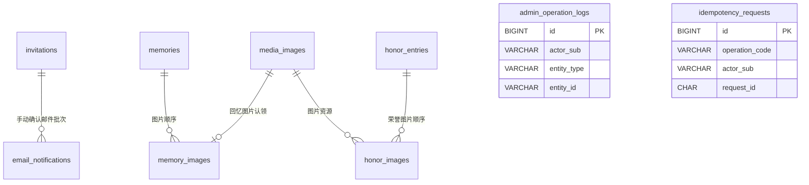

# 社团十六周年邀请函项目数据库设计

版本为 v1.2，更新日期为 2026-11-21。

本设计依据 [需求规格与实现链路 v1.5](需求规格与实现链路.md)、今年 OpenAPI 和社团既有服务实现整理。当前共 **9 张物理表、100 个字段、5 个物理外键**，覆盖报名、手动邮件、回忆投稿、简化荣誉墙和管理操作。

## 1. 数据库边界与统一约定

### 1.1 环境与数据归属

| 项目 | 约定 |
| --- | --- |
| 开发数据库 | 本机 MySQL，默认 127.0.0.1:3306，独立业务库与账号 |
| 生产数据库 | 共享 MySQL，192.168.115.23:3308，独立业务库与账号 |
| 逻辑库名 | 开发 birthday16_dev，生产 birthday16，实际名称按部署授权落实 |
| MySQL 版本 | 8.0.16 及以上，使用 CHECK、生成列索引和事务锁定读 |
| 引擎与编码 | InnoDB，utf8mb4，utf8mb4_0900_ai_ci |
| 标识符 | BIGINT 自增主键，图片采用 UUID v4；状态、UUID、摘要与身份标识采用 ASCII 区分大小写排序 |
| 时间 | DATETIME(3)，数据库连接按 UTC 保存，界面按 Asia/Shanghai 展示 |
| 空值 | 选填文本去首尾空白后为空时保存 NULL |
| 并发版本 | 可修改业务记录使用 version，业务变更加一 |
| 外键 | 同库实体使用物理外键，默认 RESTRICT |
| 删除 | 荣誉条目使用 deleted_at 软删除 |
| 年度 | 数据库服务于本次十六周年项目，开发和生产数据分别保存 |

Keycloak 保存身份，图床保存图片文件，mail-api 保存 SMTP 队列与完整发送日志。本项目保存业务记录、图片地址、已确认邮件任务和管理操作。

MySQL 8.0.16 起执行 CHECK 约束，部署前核对实际版本。[MySQL CHECK 说明](https://dev.mysql.com/doc/refman/8.0/en/create-table-check-constraints.html)

### 1.2 荣誉墙的三个业务字段

| 字段 | 规则 |
| --- | --- |
| title | 标题必填，去首尾空白后 1～100 字 |
| imageIds | 必填有序图片编号数组，至少 1 张、最多 9 张，通过 honor_images 关联 media_images |
| people | 人员必填，管理员直接填写的姓名文本，去首尾空白后 1～200 字，支持多个姓名 |

管理员表单填写标题、图片和人员姓名文本。人员直接保存到 honor_entries.people。主键、版本、操作人、时间和软删除标记为系统维护字段，用于记录识别、并发控制与删除处理。

公开荣誉列表按创建时间及编号倒序，分页默认 20、最多 50。图片可放大预览。

### 1.3 字段说明

以下字典列出全部字段的类型、空值、默认值和含义。updated_at 由应用在业务修改时显式更新。图片宽高未知时保存 NULL。外键两端类型、字符集和排序规则一致。

## 2. 全部数据表

| 序号 | 表名 | 作用 |
| --- | --- | --- |
| 1 | `invitations` | 报名回执 |
| 2 | `email_notifications` | 管理员确认的邮件批次与调用任务 |
| 3 | `media_images` | 图片上传结果 |
| 4 | `memories` | 公开回忆投稿 |
| 5 | `memory_images` | 回忆图片顺序 |
| 6 | `honor_entries` | 荣誉墙标题与图片 |
| 7 | `honor_images` | 荣誉图片顺序 |
| 8 | `admin_operation_logs` | 管理操作记录 |
| 9 | `idempotency_requests` | 管理命令幂等结果 |

## 3. 表间关系

### 3.1 ER 图



### 3.2 物理外键清单

| 子表字段 | 父表字段 | 基数与规则 |
| --- | --- | --- |
| email_notifications.invitation_id | invitations.id | 报名对应多个手动发送批次，每个批次必有报名 |
| memory_images.memory_id | memories.id | 一篇回忆可关联 0～9 张图片，正文与图片至少一项由事务校验 |
| memory_images.image_id | media_images.id | 图片必须存在，同一上传图片最多被一篇回忆认领 |
| honor_images.honor_id | honor_entries.id | 一条荣誉对应 1～9 条有序图片关联，最少 1 条由保存事务校验 |
| honor_images.image_id | media_images.id | 每条关联必须引用已有图片，同一资源可以按权限复用 |

### 3.3 逻辑关联

- invitation_version 标记确认时版本，invitation_snapshot 保存完整内容，历史通知物理外键只关联 invitations.id。
- confirmed_by_sub、uploader_sub 和 actor_sub 记录来自 Keycloak 的身份。
- remote_mail_id 通过邮件 API 查询中台任务。
- 操作日志通过 entity_type 与 entity_id 引用业务目标，幂等表保存命令结果和响应快照。
- 图片关联状态由 memory_images 与 honor_images 查询。

## 4. 全部字段、索引与约束

### 4.1 invitations — 报名回执

当前年度一人一条，手机号固定作为识别值。邮件状态由当前版本最新发送批次计算，邮件轮询不会改动报名的 updated_at。

| 字段 | MySQL 类型 | 可空 | 默认或生成方式 | 含义 |
| --- | --- | --- | --- | --- |
| `id` | `BIGINT` | 否 | `数据库自增` | 本项目内部自增主键，主键值保持稳定。 |
| `name` | `VARCHAR(50)` | 否 | `应用提供` | 真实姓名，去除首尾空白后不能为空。 |
| `phone` | `CHAR(11) CHARACTER SET ascii COLLATE ascii_bin` | 否 | `应用提供` | 唯一的 11 位大陆手机号，格式为 ^1[3-9][0-9]{9}$。 |
| `email` | `VARCHAR(254)` | 否 | `应用提供` | 接收确认邮件的邮箱，格式由服务端校验。 |
| `attendance` | `VARCHAR(16) CHARACTER SET ascii COLLATE ascii_bin` | 否 | `应用提供` | ATTENDING 到场，NOT_ATTENDING 不到场。 |
| `gift_choice` | `VARCHAR(8) CHARACTER SET ascii COLLATE ascii_bin` | 否 | `应用提供` | NONE 不需要，PICKUP 到场领取，MAIL 邮寄。 |
| `mailing_address` | `VARCHAR(500)` | 是 | `NULL` | 仅 MAIL 时必填，其他方式统一保存 NULL。 |
| `version` | `BIGINT` | 否 | `1` | 乐观锁版本，业务变更成功后加一。 |
| `created_at` | `DATETIME(3)` | 否 | `CURRENT_TIMESTAMP(3)` | 创建时间，按 UTC 保存。 |
| `updated_at` | `DATETIME(3)` | 否 | `CURRENT_TIMESTAMP(3)` | 最近业务修改时间，由应用显式更新。 |

索引与键定义如下。

- `PRIMARY KEY (id)`。
- `UNIQUE KEY uq_inv_phone (phone)`。
- `KEY ix_inv_updated (updated_at, id)`。
- `KEY ix_inv_attendance (attendance, updated_at, id)`。
- `KEY ix_inv_gift (gift_choice, updated_at, id)`。

数据库检查如下。

- `ck_inv_name` 约束 `CHAR_LENGTH(TRIM(name)) > 0`。
- `ck_inv_phone` 约束 `REGEXP_LIKE(phone, '^1[3-9][0-9]{9}$', 'c')`。
- `ck_inv_attendance` 约束 `attendance IN ('ATTENDING','NOT_ATTENDING')`。
- `ck_inv_gift` 约束 `gift_choice IN ('NONE','PICKUP','MAIL')`。
- `ck_inv_pickup` 约束 `gift_choice <> 'PICKUP' OR attendance = 'ATTENDING'`。
- `ck_inv_address` 约束 `(gift_choice = 'MAIL' AND mailing_address IS NOT NULL AND CHAR_LENGTH(TRIM(mailing_address)) > 0) OR (gift_choice <> 'MAIL' AND mailing_address IS NULL)`。
- `ck_inv_version` 约束 `version >= 1`。

### 4.2 email_notifications — 管理员确认的邮件批次与调用任务

本表同时承担本地调用任务与业务发送历史。报名保存不插入本表，只有管理员确认才创建。历史版本通过 invitation_version 和不可变快照表达。

| 字段 | MySQL 类型 | 可空 | 默认或生成方式 | 含义 |
| --- | --- | --- | --- | --- |
| `id` | `BIGINT` | 否 | `数据库自增` | 本项目内部自增主键，主键值保持稳定。 |
| `invitation_id` | `BIGINT` | 否 | `应用提供` | 关联报名记录。 |
| `invitation_version` | `BIGINT` | 否 | `应用提供` | 确认时回执版本，后续不可修改。 |
| `send_no` | `INT UNSIGNED` | 否 | `应用提供` | 同一报名同一版本的发送批次，从 1 递增。 |
| `confirmation_request_id` | `CHAR(36) CHARACTER SET ascii COLLATE ascii_bin` | 否 | `应用提供` | 管理员本次确认的 UUID，网络重试保持一致。 |
| `confirmation_request_hash` | `CHAR(64) CHARACTER SET ascii COLLATE ascii_bin` | 否 | `应用提供` | 确认参数规范化后的 SHA-256，识别同键不同请求。 |
| `confirmed_by_sub` | `VARCHAR(128) CHARACTER SET ascii COLLATE ascii_bin` | 否 | `应用提供` | 操作人员的 Keycloak sub，从已验证令牌获取。 |
| `confirmed_by_name` | `VARCHAR(150)` | 是 | `NULL` | 确认人用户名或显示名快照，用于后台历史。 |
| `confirmed_at` | `DATETIME(3)` | 否 | `应用提供` | 管理员实际确认时间。 |
| `environment` | `VARCHAR(16) CHARACTER SET ascii COLLATE ascii_bin` | 否 | `应用提供` | 开发、生产实例标识，参与中台幂等键生成。 |
| `client_key` | `VARCHAR(128) CHARACTER SET ascii COLLATE ascii_bin` | 否 | `应用提供` | 向邮件中台提交的稳定幂等键，全局唯一。 |
| `invitation_snapshot` | `JSON` | 否 | `应用提供` | 确认时回执快照，含版本、姓名、手机号、邮箱、到场、礼物、地址，并记录 mailTemplateVersion 与 mailPreviewHash。 |
| `recipient_email` | `VARCHAR(254)` | 否 | `应用提供` | 本批次收件邮箱快照。 |
| `subject` | `VARCHAR(200)` | 否 | `应用提供` | 确认时渲染的邮件主题。 |
| `text_body` | `MEDIUMTEXT` | 否 | `应用提供` | 纯文本正文快照，重试沿用。 |
| `html_body` | `MEDIUMTEXT` | 是 | `应用提供` | HTML 正文快照，可为空。 |
| `task_status` | `VARCHAR(24) CHARACTER SET ascii COLLATE ascii_bin` | 否 | `'READY'` | 本地任务状态，详见状态机章节。 |
| `remote_mail_id` | `CHAR(36) CHARACTER SET ascii COLLATE ascii_bin` | 是 | `NULL` | 邮件中台返回的任务 UUID，受理前为空。 |
| `remote_status` | `VARCHAR(16) CHARACTER SET ascii COLLATE ascii_bin` | 是 | `NULL` | 中台 queued、sending、sent、failed。 |
| `remote_attempts` | `INT UNSIGNED` | 是 | `NULL` | 最近一次查询到的 SMTP 尝试次数。 |
| `accepted_at` | `DATETIME(3)` | 是 | `NULL` | 首次确认中台已受理的时间。 |
| `sent_at` | `DATETIME(3)` | 是 | `NULL` | 中台 sent_at，表示 SMTP 发送成功。 |
| `submit_attempts` | `INT UNSIGNED` | 否 | `0` | 本项目调用中台提交接口的累计次数，与 SMTP 次数分开。 |
| `poll_failures` | `INT UNSIGNED` | 否 | `0` | 连续状态查询失败次数，查询成功后清零。 |
| `last_error_code` | `VARCHAR(64) CHARACTER SET ascii COLLATE ascii_bin` | 是 | `NULL` | 本地归一化错误代码。 |
| `last_error_message` | `VARCHAR(2000)` | 是 | `NULL` | 经过脱敏与截断的失败原因。 |
| `next_run_at` | `DATETIME(3)` | 是 | `CURRENT_TIMESTAMP(3)` | 下次可执行或查询时间，终态清空。 |
| `lease_owner` | `VARCHAR(64) CHARACTER SET ascii COLLATE ascii_bin` | 是 | `NULL` | 持有任务的应用实例或工作器。 |
| `lease_token` | `CHAR(36) CHARACTER SET ascii COLLATE ascii_bin` | 是 | `NULL` | 每次领取生成的新 UUID，用于拒绝旧工作器回写。 |
| `lease_until` | `DATETIME(3)` | 是 | `NULL` | 占用期限，过期后可恢复。 |
| `version` | `BIGINT` | 否 | `1` | 乐观锁版本，业务变更成功后加一。 |
| `created_at` | `DATETIME(3)` | 否 | `CURRENT_TIMESTAMP(3)` | 创建时间，按 UTC 保存。 |
| `updated_at` | `DATETIME(3)` | 否 | `CURRENT_TIMESTAMP(3)` | 最近业务修改时间，由应用显式更新。 |
| `active_marker` | `TINYINT` | 生成结果可空 | `由 task_status 生成` | 生成列，活动批次为 1，终态为 NULL，实现每个回执版本最多一个活动批次。 |

索引与键定义如下。

- `PRIMARY KEY (id)`。
- `UNIQUE KEY uq_email_batch (invitation_id, invitation_version, send_no)`。
- `UNIQUE KEY uq_email_confirmation (confirmed_by_sub, confirmation_request_id)`。
- `UNIQUE KEY uq_email_client (client_key)`。
- `UNIQUE KEY uq_email_remote (remote_mail_id)`。
- `UNIQUE KEY uq_email_active (invitation_id, invitation_version, active_marker)`。
- `KEY ix_email_schedule (task_status, next_run_at, lease_until, id)`。

外键关联如下。

- `fk_email_invitation` 将 `invitation_id` 关联到 `invitations.id`，采用 RESTRICT。

数据库检查如下。

- `ck_email_version` 约束 `invitation_version >= 1 AND version >= 1 AND send_no >= 1`。
- `ck_email_task` 约束 `task_status IN ('READY','SUBMITTING','SUBMIT_RETRY','SUBMIT_UNKNOWN','POLLING','SUCCEEDED','FAILED','CANCELLED','DISABLED')`。
- `ck_email_remote` 约束 `remote_status IS NULL OR remote_status IN ('queued','sending','sent','failed')`。
- `ck_email_snapshot` 约束 `JSON_TYPE(invitation_snapshot) = 'OBJECT'`。
- `ck_email_body` 约束 `CHAR_LENGTH(TRIM(subject)) > 0 AND CHAR_LENGTH(TRIM(text_body)) > 0`。
- `ck_email_lease` 约束 `(lease_owner IS NULL AND lease_token IS NULL AND lease_until IS NULL) OR (lease_owner IS NOT NULL AND lease_token IS NOT NULL AND lease_until IS NOT NULL)`。

### 4.3 media_images — 图片上传结果

回忆图和荣誉图统一引用本表。关联状态由 memory_images 与 honor_images 查询，图片文件由社团图床保存。

| 字段 | MySQL 类型 | 可空 | 默认或生成方式 | 含义 |
| --- | --- | --- | --- | --- |
| `id` | `CHAR(36) CHARACTER SET ascii COLLATE ascii_bin` | 否 | `应用提供` | 服务端生成 UUID v4，作为对外图片编号与主键。 |
| `url` | `VARCHAR(2048)` | 否 | `应用提供` | file-api 返回的正式图片 URL。 |
| `original_name` | `VARCHAR(255)` | 否 | `应用提供` | 规范化后的原始文件名，仅保存文件名。 |
| `uploaded_name` | `VARCHAR(255)` | 是 | `NULL` | file-api 返回的重命名文件名。 |
| `source_mime_type` | `VARCHAR(50) CHARACTER SET ascii COLLATE ascii_bin` | 否 | `应用提供` | 本项目检测的输入格式。 |
| `source_size_bytes` | `INT UNSIGNED` | 否 | `应用提供` | 上传原文件字节数，最大 10 MiB。 |
| `stored_size_bytes` | `INT UNSIGNED` | 是 | `NULL` | 上游明确提供的实际存储字节数，未知时为空。 |
| `width` | `INT UNSIGNED` | 是 | `NULL` | 最终图片宽度，未知时为空。 |
| `height` | `INT UNSIGNED` | 是 | `NULL` | 最终图片高度，未知时为空。 |
| `uploader_sub` | `VARCHAR(128) CHARACTER SET ascii COLLATE ascii_bin` | 是 | `NULL` | 登录上传者的 Keycloak sub。 |
| `upload_owner_hash` | `CHAR(64) CHARACTER SET ascii COLLATE ascii_bin` | 是 | `NULL` | 匿名上传会话凭据的 SHA-256，校验图片关联权。 |
| `created_at` | `DATETIME(3)` | 否 | `CURRENT_TIMESTAMP(3)` | 创建时间，按 UTC 保存。 |

索引与键定义如下。

- `PRIMARY KEY (id)`。
- `KEY ix_media_created (created_at, id)`。
- `KEY ix_media_uploader (uploader_sub, created_at)`。
- `KEY ix_media_owner (upload_owner_hash)`。

数据库检查如下。

- `ck_media_size` 约束 `source_size_bytes > 0 AND source_size_bytes <= 10485760`。
- `ck_media_mime` 约束 `source_mime_type IN ('image/jpeg','image/png','image/webp','image/gif')`。
- `ck_media_dimensions` 约束 `(width IS NULL AND height IS NULL) OR (width IS NOT NULL AND height IS NOT NULL AND width > 0 AND height > 0)`。
- `ck_media_owner` 约束 `uploader_sub IS NOT NULL OR upload_owner_hash IS NOT NULL`。
- `ck_media_url` 约束 `CHAR_LENGTH(TRIM(url)) > 0`。

### 4.4 memories — 公开回忆投稿

姓名和标题可空，不设置审核状态。图文至少一项涉及跨表，在同一事务中校验与发布。

| 字段 | MySQL 类型 | 可空 | 默认或生成方式 | 含义 |
| --- | --- | --- | --- | --- |
| `id` | `BIGINT` | 否 | `数据库自增` | 本项目内部自增主键，主键值保持稳定。 |
| `submission_id` | `CHAR(36) CHARACTER SET ascii COLLATE ascii_bin` | 否 | `应用提供` | 前端生成的投稿 UUID，重试保持一致。 |
| `submission_hash` | `CHAR(64) CHARACTER SET ascii COLLATE ascii_bin` | 否 | `应用提供` | 姓名、标题、正文与有序图片编号的规范化 SHA-256。 |
| `display_name` | `VARCHAR(50)` | 是 | `NULL` | 选填，空白统一为 NULL，前端按匿名显示。 |
| `title` | `VARCHAR(100)` | 是 | `NULL` | 选填，空白统一为 NULL。 |
| `content` | `TEXT` | 是 | `应用提供` | 选填，最多 5000 字。正文或图片至少一项由发布事务校验。 |
| `published_at` | `DATETIME(3)` | 否 | `CURRENT_TIMESTAMP(3)` | 事务提交后即公开，列表按此时间和 id 倒序。 |

索引与键定义如下。

- `PRIMARY KEY (id)`。
- `UNIQUE KEY uq_memory_submission (submission_id)`。
- `KEY ix_memory_published (published_at, id)`。

数据库检查如下。

- `ck_memory_name` 约束 `display_name IS NULL OR CHAR_LENGTH(TRIM(display_name)) > 0`。
- `ck_memory_title` 约束 `title IS NULL OR CHAR_LENGTH(TRIM(title)) > 0`。
- `ck_memory_content` 约束 `content IS NULL OR (CHAR_LENGTH(TRIM(content)) > 0 AND CHAR_LENGTH(content) <= 5000)`。

### 4.5 memory_images — 回忆图片顺序

同一上传图片最多关联一篇回忆，其他业务的允许复用规则由上传者校验及所属内容事务控制。

| 字段 | MySQL 类型 | 可空 | 默认或生成方式 | 含义 |
| --- | --- | --- | --- | --- |
| `memory_id` | `BIGINT` | 否 | `应用提供` | 所属回忆。 |
| `image_id` | `CHAR(36) CHARACTER SET ascii COLLATE ascii_bin` | 否 | `应用提供` | 图片编号。 |
| `position` | `TINYINT UNSIGNED` | 否 | `应用提供` | 从 1 开始的展示顺序，范围 1～9。 |

索引与键定义如下。

- `PRIMARY KEY (memory_id, image_id)`。
- `UNIQUE KEY uq_memory_image_position (memory_id, position)`。
- `UNIQUE KEY uq_memory_image_claim (image_id)`。

外键关联如下。

- `fk_memory_image_memory` 将 `memory_id` 关联到 `memories.id`，采用 RESTRICT。
- `fk_memory_image_media` 将 `image_id` 关联到 `media_images.id`，采用 RESTRICT。

数据库检查如下。

- `ck_memory_image_position` 约束 `position BETWEEN 1 AND 9`。

### 4.6 honor_entries — 荣誉墙标题与图片

管理员填写 title、people 与有序 imageIds。图片通过 honor_images 保存，人员文本直接存于本表，其余字段由系统维护。

| 字段 | MySQL 类型 | 可空 | 默认或生成方式 | 含义 |
| --- | --- | --- | --- | --- |
| `id` | `BIGINT` | 否 | `数据库自增` | 系统自增主键。 |
| `title` | `VARCHAR(100)` | 否 | `应用提供` | 必填业务字段，去首尾空白后 1～100 字。 |
| `people` | `VARCHAR(200)` | 否 | `应用提供` | 必填人员姓名文本，由管理员直接输入，可包含多个姓名。 |
| `version` | `BIGINT` | 否 | `1` | 系统维护的乐观锁版本。 |
| `created_by_sub` | `VARCHAR(128) CHARACTER SET ascii COLLATE ascii_bin` | 否 | `应用提供` | 系统从 SSO 令牌记录创建人。 |
| `updated_by_sub` | `VARCHAR(128) CHARACTER SET ascii COLLATE ascii_bin` | 否 | `应用提供` | 系统记录最近修改人。 |
| `created_at` | `DATETIME(3)` | 否 | `CURRENT_TIMESTAMP(3)` | 系统创建时间，UTC。 |
| `updated_at` | `DATETIME(3)` | 否 | `CURRENT_TIMESTAMP(3)` | 系统最近修改时间，UTC。 |
| `deleted_at` | `DATETIME(3)` | 是 | `NULL` | 系统软删除时间，NULL 表示公开有效。 |

索引与键定义如下。

- `PRIMARY KEY (id)`。
- `KEY ix_honor_public (deleted_at, created_at, id)`。
- `KEY ix_honor_admin (deleted_at, updated_at, id)`。

数据库检查如下。

- `ck_honor_title` 约束 `CHAR_LENGTH(TRIM(title)) > 0`。
- `ck_honor_version` 约束 `version >= 1`。
- `ck_honor_people` 约束 `CHAR_LENGTH(TRIM(people)) > 0`。

### 4.7 honor_images — 荣誉图片顺序

每条荣誉的完整图片集合在保存事务中校验为 1～9 张。同条目图片和顺序均不可重复。

| 字段 | MySQL 类型 | 可空 | 默认或生成方式 | 含义 |
| --- | --- | --- | --- | --- |
| `honor_id` | `BIGINT` | 否 | `应用提供` | 所属荣誉条目。 |
| `image_id` | `CHAR(36) CHARACTER SET ascii COLLATE ascii_bin` | 否 | `应用提供` | 关联已经上传的图片编号。 |
| `position` | `TINYINT UNSIGNED` | 否 | `应用提供` | 从 1 开始的展示顺序，范围 1～9。 |

索引与键定义如下。

- `PRIMARY KEY (honor_id, image_id)`。
- `UNIQUE KEY uq_honor_image_position (honor_id, position)`。
- `KEY ix_honor_image_reverse (image_id)`。

外键关联如下。

- `fk_honor_images_honor` 将 `honor_id` 关联到 `honor_entries.id`，采用 RESTRICT。
- `fk_honor_images_media` 将 `image_id` 关联到 `media_images.id`，采用 RESTRICT。

数据库检查如下。

- `ck_honor_image_position` 约束 `position BETWEEN 1 AND 9`。

### 4.8 admin_operation_logs — 管理操作记录

操作成功记录与业务变更同事务保存。entity_id 是多种实体的引用，应用校验其含义。SSO 身份凭证由认证服务管理。

| 字段 | MySQL 类型 | 可空 | 默认或生成方式 | 含义 |
| --- | --- | --- | --- | --- |
| `id` | `BIGINT` | 否 | `数据库自增` | 本项目内部自增主键，主键值保持稳定。 |
| `actor_sub` | `VARCHAR(128) CHARACTER SET ascii COLLATE ascii_bin` | 否 | `应用提供` | 来自已验证 SSO 令牌的操作人 sub。 |
| `actor_name` | `VARCHAR(150)` | 是 | `NULL` | 当时用户名或显示名快照。 |
| `action` | `VARCHAR(40) CHARACTER SET ascii COLLATE ascii_bin` | 否 | `应用提供` | 操作代码，例如 INVITATION_UPDATE、EMAIL_CONFIRM、HONOR_CREATE、HONOR_UPDATE、HONOR_DELETE。 |
| `entity_type` | `VARCHAR(32) CHARACTER SET ascii COLLATE ascii_bin` | 否 | `应用提供` | 目标实体类型。 |
| `entity_id` | `VARCHAR(64) CHARACTER SET ascii COLLATE ascii_bin` | 否 | `应用提供` | 目标编号的字符串表达。 |
| `trace_id` | `CHAR(36) CHARACTER SET ascii COLLATE ascii_bin` | 否 | `应用提供` | 当前 HTTP 请求的服务端追踪 UUID。 |
| `operation_request_id` | `CHAR(36) CHARACTER SET ascii COLLATE ascii_bin` | 是 | `NULL` | 调用方幂等操作 UUID，存在时记录。 |
| `changes` | `JSON` | 是 | `应用提供` | 必要业务字段差异或邮件版本、批次、荣誉图片变更摘要。 |
| `created_at` | `DATETIME(3)` | 否 | `CURRENT_TIMESTAMP(3)` | 创建时间，按 UTC 保存。 |

索引与键定义如下。

- `PRIMARY KEY (id)`。
- `KEY ix_audit_entity (entity_type, entity_id, created_at, id)`。
- `KEY ix_audit_actor (actor_sub, created_at, id)`。
- `KEY ix_audit_trace (trace_id)`。

### 4.9 idempotency_requests — 管理命令幂等结果

与管理命令在同一事务中创建和完成，事务失败整体回滚。公开投稿使用 memories.submission_id，邮件确认使用 email_notifications 的唯一确认键。

| 字段 | MySQL 类型 | 可空 | 默认或生成方式 | 含义 |
| --- | --- | --- | --- | --- |
| `id` | `BIGINT` | 否 | `数据库自增` | 本项目内部自增主键，主键值保持稳定。 |
| `operation_code` | `VARCHAR(40) CHARACTER SET ascii COLLATE ascii_bin` | 否 | `应用提供` | 命令范围，例如 HONOR_CREATE、HONOR_UPDATE、HONOR_DELETE、INVITATION_UPDATE。 |
| `actor_sub` | `VARCHAR(128) CHARACTER SET ascii COLLATE ascii_bin` | 否 | `应用提供` | 命令执行人的 SSO sub。 |
| `request_id` | `CHAR(36) CHARACTER SET ascii COLLATE ascii_bin` | 否 | `应用提供` | 同一次操作保持稳定的 UUID。 |
| `request_hash` | `CHAR(64) CHARACTER SET ascii COLLATE ascii_bin` | 否 | `应用提供` | 规范化请求体 SHA-256，防止同键不同参数。 |
| `state` | `VARCHAR(12) CHARACTER SET ascii COLLATE ascii_bin` | 否 | `'PROCESSING'` | PROCESSING 为事务内处理中，COMPLETED 为已完成。 |
| `resource_type` | `VARCHAR(32) CHARACTER SET ascii COLLATE ascii_bin` | 是 | `NULL` | 成功创建或更新的目标类型。 |
| `resource_id` | `VARCHAR(64) CHARACTER SET ascii COLLATE ascii_bin` | 是 | `NULL` | 目标编号。 |
| `response_status` | `SMALLINT UNSIGNED` | 是 | `NULL` | 成功响应的 HTTP 状态。 |
| `response_body` | `JSON` | 是 | `应用提供` | 用于重复请求返回原结果的响应快照。 |
| `created_at` | `DATETIME(3)` | 否 | `CURRENT_TIMESTAMP(3)` | 创建时间，按 UTC 保存。 |
| `completed_at` | `DATETIME(3)` | 是 | `NULL` | 完成时间，与响应快照在同一事务保存。 |

索引与键定义如下。

- `PRIMARY KEY (id)`。
- `UNIQUE KEY uq_idem_command (operation_code, actor_sub, request_id)`。
- `KEY ix_idem_created (created_at, id)`。

数据库检查如下。

- `ck_idem_state` 约束 `state IN ('PROCESSING','COMPLETED')`。
- `ck_idem_response` 约束 `(state = 'PROCESSING' AND completed_at IS NULL) OR (state = 'COMPLETED' AND completed_at IS NOT NULL AND response_status IS NOT NULL AND response_body IS NOT NULL)`。

## 5. 业务约束分工

| 约束 | 数据库 | 应用事务 |
| --- | --- | --- |
| 大陆手机号唯一 | 唯一键与格式 CHECK | 去空白、字段反馈、并发创建重试 |
| 到场两种状态 | attendance CHECK | 对应表单与校验 |
| 不到场不能现场领取 | 跨字段 CHECK | 隐藏并清理失效选择 |
| 邮寄需地址 | 跨字段 CHECK | 去空白、长度反馈 |
| 回忆图文至少一项 | 单字段长度与图片外键 | 同事务校验正文或图片关联非空 |
| 回忆最多 9 张图 | position 1～9、顺序唯一 | 上传者与可关联性校验 |
| 荣誉标题必填 | NOT NULL 与非空白 CHECK | 标题去空白、长度反馈 |
| 荣誉图片必填且最多 9 张 | 图片外键、position 1～9、顺序和图片唯一 | 保存完整集合时校验 1～9 张及上传归属 |
| 荣誉人员必填 | people 的 NOT NULL 与非空白 CHECK | 校验管理员直接填写的姓名文本和长度 |
| 手动确认发信 | 确认信息必填 | 只由管理员确认入口创建任务 |
| 同版本一个活动批次 | 生成列与复合唯一键 | 父记录锁和任务复用 |
| 幂等请求 | 业务键或命令键唯一 | 摘要一致时返回原结果 |
| 并发修改 | version 字段 | expectedVersion 更新，冲突 409 |
| 荣誉软删除 | deleted_at 与索引 | 公开查询排除已删除记录 |

图片上传归属通过登录者或匿名会话摘要校验，正文与图片至少一项在发布事务中处理。荣誉图片由 honor_images 有序关联，至少 1 张在父记录保存事务中校验。

## 6. 邮件状态与任务恢复

### 6.1 本地状态

| task_status | 含义 | 下一步 |
| --- | --- | --- |
| READY | 管理员已确认，等待调用 | 领取后检查版本并提交 |
| SUBMITTING | 当前工作器正在调用中台 | 受理成功转 POLLING，超时按结果是否确定分类 |
| SUBMIT_RETRY | 明确可以重试的调用失败 | 到 next_run_at 后重试 |
| SUBMIT_UNKNOWN | 调用结果不确定，可能已入队 | 同版本使用原 client_key 核对；过时版本记录待核实 |
| POLLING | 已取得中台编号，持续查状态 | queued/sending 继续等待，sent 成功，failed 失败 |
| SUCCEEDED | SMTP 已发送 | 终态 |
| FAILED | 最终失败或明确的配置错误 | 终态，管理员可确认新批次 |
| CANCELLED | 确认任务尚未提交且版本已过时 | 终态，当前版本等待重新确认 |
| DISABLED | 当前环境禁止实际发信 | 终态 |

活动状态生成 active_marker=1，其余为 NULL。唯一索引 (invitation_id, invitation_version, active_marker) 保证同版本活动任务唯一，允许保存多次终态历史。MySQL 唯一索引允许多个 NULL。[MySQL 唯一索引说明](https://dev.mysql.com/doc/refman/8.0/en/create-index.html)

### 6.2 对外状态推导

对每条报名取与当前 version 相同、send_no 最大的通知，按以下规则生成 API 字段。

| 情况 | emailNotifyStatus | emailNotifiedAt |
| --- | --- | --- |
| 当前版本没有通知，或最后任务为 CANCELLED | NOT_SENT | NULL |
| READY、SUBMITTING、SUBMIT_RETRY、SUBMIT_UNKNOWN、POLLING | PENDING | NULL |
| SUCCEEDED | SUCCESS | 该通知 sent_at |
| FAILED | FAILED | NULL |
| DISABLED | DISABLED | NULL |

历史已成功批次仍可单独查询。当前版本最新批次失败时，当前摘要为 FAILED，较早成功记录保留在历史。

### 6.3 任务领取与恢复

1. 使用短事务选择到期且租约为空或已过期的任务，锁定记录并生成 lease_token。
2. 保存 lease_owner、lease_token、lease_until，提交事务后执行 HTTP 调用。
3. 回写时同时匹配 id 与 lease_token，防止过期工作器覆盖新工作器结果。
4. 受理前重试沿用 client_key，受理后只查询已有 remote_mail_id。
5. 终态清空 next_run_at 和租约字段，释放活动批次唯一槽位。
6. 进程重启后重新领取到期任务。

可用 FOR UPDATE SKIP LOCKED 处理并发队列领取，索引 ix_email_schedule 支持状态和到期条件扫描。[MySQL 锁定读说明](https://dev.mysql.com/doc/refman/8.0/en/select.html)

### 6.4 版本变化与不确定受理

管理员确认保存的是该时刻快照。发起外部请求前锁定并核对当前回执版本，明确尚未提交且版本过时的任务取消。

请求已发出但响应丢失时，不能仅凭本地缺少邮件编号就认定中台没有受理，使用 SUBMIT_UNKNOWN 表达该情况。同版本可用原 client_key 重试并取回原任务。若此时回执版本已过时，应暂停可能新建旧内容邮件的调用，记录待核实原因，保留历史查询与排查信息。

外部请求发起与第三方入队之间存在跨服务边界，本项目通过稳定幂等键和不可变快照处理重试。中台一旦受理，即按其已有能力继续发送和查询。

## 7. 关键事务与表协作

### 7.1 创建或更新报名

- 按手机号查询并锁定已有 invitations 记录，首次创建冲突时捕获唯一键错误并重新读取。
- 规范化字段后比较实际业务内容，变化时 version 加一，更新 updated_at。
- 完全相同的提交保留业务版本。
- 管理员更正时校验 expectedVersion，并在同事务写 admin_operation_logs。
- 当前版本的 NOT_SENT 通过通知不存在推导。

### 7.2 手动确认邮件

1. 从已验证用户令牌取得 confirmed_by_sub。
2. 优先查询该用户与 confirmation_request_id 的已有结果，摘要一致时返回原通知，不一致返回 409。
3. 锁定 invitations，核对 expectedVersion，并重新渲染预览比对 previewHash。
4. 查询同版本活动通知，确认内容一致时复用；内容不同返回 EMAIL_SEND_IN_PROGRESS，避免混淆不同预览。
5. 在锁保护下计算当前版本下一 send_no。
6. 保存回执、收件邮箱、预览正文及模板版本，将预览摘要写入 invitation_snapshot.mailPreviewHash，生成稳定 client_key。
7. 插入 email_notifications 与管理日志，提交后由后台处理。

### 7.3 图片上传与投稿发布

- file-api 上传成功后保存 media_images，图片 UUID 返回前端。
- 匿名会话或登录身份作为图片后续关联的归属依据。实际压缩后尺寸未知时保持 NULL。
- 投稿按 submission_id 去重，对比 submission_hash，参数改变返回 409。
- 锁定图片并检查上传者、可关联性、数量及正文条件。
- 同事务插入 memories 和 memory_images，提交后直接公开。
- 失败回滚业务记录，已上传图片保留为未关联资源，可继续重试。


### 7.4 保存荣誉条目

1. 管理员通过 SSO 登录，逐张上传 1～9 张图片并取得图片编号。
2. 提交 title、imageIds、people，系统附带 requestId 或 expectedVersion。
3. 创建时通过 idempotency_requests 处理重复操作，编辑时锁定已有条目并校验版本。
4. 校验标题与人员非空和长度，以及 1～9 张图片的存在性、去重和关联权限。
5. 同事务保存 honor_entries、honor_images 展示顺序、操作日志和幂等结果。
6. 提交后公开列表读取最新内容。

标题、图片或人员任一缺失都拒绝保存。编辑图片时先校验完整 imageIds 集合，再在父记录锁下事务替换 honor_images；失败整体回滚，原图片按已有引用和图床能力处理。

### 7.5 删除荣誉条目

管理员二次确认后提交版本，后端更新 deleted_at、updated_at、updated_by_sub 和 version，记录操作日志。公开列表排除该条目。图片引用继续保留，以便历史完整性与后续维护。

### 7.6 幂等命令事务

管理命令在同一事务中将 idempotency_requests 从 PROCESSING 完成到 COMPLETED，并保存原响应。事务回滚时该行一起回滚。

重复请求依靠唯一键等待原事务结束。已完成时比较摘要并返回原响应，失败回滚后可重新执行。公开投稿与确认邮件分别使用其业务表中的专用唯一键。

## 8. 查询与索引使用

### 8.1 报名与邮件摘要

```sql
SELECT i.id, i.name, i.phone, i.email, i.attendance, i.gift_choice,
       i.mailing_address, i.version, i.created_at, i.updated_at,
       CASE
         WHEN n.id IS NULL OR n.task_status = 'CANCELLED' THEN 'NOT_SENT'
         WHEN n.task_status = 'SUCCEEDED' THEN 'SUCCESS'
         WHEN n.task_status = 'FAILED' THEN 'FAILED'
         WHEN n.task_status = 'DISABLED' THEN 'DISABLED'
         ELSE 'PENDING'
       END AS email_notify_status,
       CASE WHEN n.task_status = 'SUCCEEDED' THEN n.sent_at END AS email_notified_at
FROM invitations AS i
LEFT JOIN email_notifications AS n
  ON n.id = (
    SELECT e.id
    FROM email_notifications AS e
    WHERE e.invitation_id = i.id AND e.invitation_version = i.version
    ORDER BY e.send_no DESC
    LIMIT 1
  )
ORDER BY i.updated_at DESC, i.id DESC
LIMIT 20 OFFSET 0;
```

使用同一查询逻辑构建统计和 CSV 导出。旧版本通知始终留在历史查询中。


### 8.2 公开荣誉列表

先分页取得荣誉记录。

```sql
SELECT h.id, h.title, h.people
FROM honor_entries AS h
WHERE h.deleted_at IS NULL
ORDER BY h.created_at DESC, h.id DESC
LIMIT 20 OFFSET 0;
```

再按本页编号批量读取有序图片。

```sql
SELECT hi.honor_id, hi.position, m.url AS image_url
FROM honor_images AS hi
JOIN media_images AS m ON m.id = hi.image_id
WHERE hi.honor_id IN (1, 2)
ORDER BY hi.honor_id, hi.position;
```

应用按 honor_id 组装图片数组，首图可作封面，预览保留完整顺序。示例编号由实际分页结果参数化提供。ix_honor_public 支持稳定排序，关联表顺序索引支持批量读取。后台列表额外返回版本及系统时间。

### 8.3 回忆列表

memories 按 published_at、id 倒序，先取得本页回忆编号，再批量查询 memory_images 和 media_images，按 position 组装。封面取第一条图片关联，正文和完整图片通过详情接口提供。

## 9. 删除、迁移与维护

- 荣誉采用软删除，图片引用和操作记录保留。
- 回忆关联顺序在父记录事务锁下整组替换，避免交换顺序时触发唯一键冲突。
- 正被引用的图片受 RESTRICT 保护，图床实际文件按服务方能力维护。
- 生日联系方式与地址通过管理接口访问，公开荣誉返回标题、图片和人员文本。
- 开发与生产独立执行同一版本迁移，业务、邮件任务、图片关联、幂等记录和日志一起备份。
- 正式数据库名与账号由环境配置落实，迁移工具自行管理迁移元数据。

## 10. 完整建表 SQL

以下为新独立业务库的 9 张表，按外键依赖顺序排列。执行前选择已授权的目标库。

```sql
SET NAMES utf8mb4;

SET time_zone = '+00:00';

CREATE TABLE invitations (
  `id` BIGINT NOT NULL AUTO_INCREMENT,
  `name` VARCHAR(50) NOT NULL,
  `phone` CHAR(11) CHARACTER SET ascii COLLATE ascii_bin NOT NULL,
  `email` VARCHAR(254) NOT NULL,
  `attendance` VARCHAR(16) CHARACTER SET ascii COLLATE ascii_bin NOT NULL,
  `gift_choice` VARCHAR(8) CHARACTER SET ascii COLLATE ascii_bin NOT NULL,
  `mailing_address` VARCHAR(500) NULL DEFAULT NULL,
  `version` BIGINT NOT NULL DEFAULT 1,
  `created_at` DATETIME(3) NOT NULL DEFAULT CURRENT_TIMESTAMP(3),
  `updated_at` DATETIME(3) NOT NULL DEFAULT CURRENT_TIMESTAMP(3),
  PRIMARY KEY (id),
  UNIQUE KEY uq_inv_phone (phone),
  KEY ix_inv_updated (updated_at, id),
  KEY ix_inv_attendance (attendance, updated_at, id),
  KEY ix_inv_gift (gift_choice, updated_at, id),
  CONSTRAINT ck_inv_name CHECK (CHAR_LENGTH(TRIM(name)) > 0),
  CONSTRAINT ck_inv_phone CHECK (REGEXP_LIKE(phone, '^1[3-9][0-9]{9}$', 'c')),
  CONSTRAINT ck_inv_attendance CHECK (attendance IN ('ATTENDING','NOT_ATTENDING')),
  CONSTRAINT ck_inv_gift CHECK (gift_choice IN ('NONE','PICKUP','MAIL')),
  CONSTRAINT ck_inv_pickup CHECK (gift_choice <> 'PICKUP' OR attendance = 'ATTENDING'),
  CONSTRAINT ck_inv_address CHECK ((gift_choice = 'MAIL' AND mailing_address IS NOT NULL AND CHAR_LENGTH(TRIM(mailing_address)) > 0) OR (gift_choice <> 'MAIL' AND mailing_address IS NULL)),
  CONSTRAINT ck_inv_version CHECK (version >= 1)
) ENGINE=InnoDB DEFAULT CHARSET=utf8mb4 COLLATE=utf8mb4_0900_ai_ci;

CREATE TABLE email_notifications (
  `id` BIGINT NOT NULL AUTO_INCREMENT,
  `invitation_id` BIGINT NOT NULL,
  `invitation_version` BIGINT NOT NULL,
  `send_no` INT UNSIGNED NOT NULL,
  `confirmation_request_id` CHAR(36) CHARACTER SET ascii COLLATE ascii_bin NOT NULL,
  `confirmation_request_hash` CHAR(64) CHARACTER SET ascii COLLATE ascii_bin NOT NULL,
  `confirmed_by_sub` VARCHAR(128) CHARACTER SET ascii COLLATE ascii_bin NOT NULL,
  `confirmed_by_name` VARCHAR(150) NULL DEFAULT NULL,
  `confirmed_at` DATETIME(3) NOT NULL,
  `environment` VARCHAR(16) CHARACTER SET ascii COLLATE ascii_bin NOT NULL,
  `client_key` VARCHAR(128) CHARACTER SET ascii COLLATE ascii_bin NOT NULL,
  `invitation_snapshot` JSON NOT NULL,
  `recipient_email` VARCHAR(254) NOT NULL,
  `subject` VARCHAR(200) NOT NULL,
  `text_body` MEDIUMTEXT NOT NULL,
  `html_body` MEDIUMTEXT NULL,
  `task_status` VARCHAR(24) CHARACTER SET ascii COLLATE ascii_bin NOT NULL DEFAULT 'READY',
  `remote_mail_id` CHAR(36) CHARACTER SET ascii COLLATE ascii_bin NULL DEFAULT NULL,
  `remote_status` VARCHAR(16) CHARACTER SET ascii COLLATE ascii_bin NULL DEFAULT NULL,
  `remote_attempts` INT UNSIGNED NULL DEFAULT NULL,
  `accepted_at` DATETIME(3) NULL DEFAULT NULL,
  `sent_at` DATETIME(3) NULL DEFAULT NULL,
  `submit_attempts` INT UNSIGNED NOT NULL DEFAULT 0,
  `poll_failures` INT UNSIGNED NOT NULL DEFAULT 0,
  `last_error_code` VARCHAR(64) CHARACTER SET ascii COLLATE ascii_bin NULL DEFAULT NULL,
  `last_error_message` VARCHAR(2000) NULL DEFAULT NULL,
  `next_run_at` DATETIME(3) NULL DEFAULT CURRENT_TIMESTAMP(3),
  `lease_owner` VARCHAR(64) CHARACTER SET ascii COLLATE ascii_bin NULL DEFAULT NULL,
  `lease_token` CHAR(36) CHARACTER SET ascii COLLATE ascii_bin NULL DEFAULT NULL,
  `lease_until` DATETIME(3) NULL DEFAULT NULL,
  `version` BIGINT NOT NULL DEFAULT 1,
  `created_at` DATETIME(3) NOT NULL DEFAULT CURRENT_TIMESTAMP(3),
  `updated_at` DATETIME(3) NOT NULL DEFAULT CURRENT_TIMESTAMP(3),
  `active_marker` TINYINT GENERATED ALWAYS AS (CASE WHEN task_status IN ('READY','SUBMITTING','SUBMIT_RETRY','SUBMIT_UNKNOWN','POLLING') THEN 1 ELSE NULL END) VIRTUAL,
  PRIMARY KEY (id),
  UNIQUE KEY uq_email_batch (invitation_id, invitation_version, send_no),
  UNIQUE KEY uq_email_confirmation (confirmed_by_sub, confirmation_request_id),
  UNIQUE KEY uq_email_client (client_key),
  UNIQUE KEY uq_email_remote (remote_mail_id),
  UNIQUE KEY uq_email_active (invitation_id, invitation_version, active_marker),
  KEY ix_email_schedule (task_status, next_run_at, lease_until, id),
  CONSTRAINT fk_email_invitation FOREIGN KEY (invitation_id) REFERENCES invitations (id),
  CONSTRAINT ck_email_version CHECK (invitation_version >= 1 AND version >= 1 AND send_no >= 1),
  CONSTRAINT ck_email_task CHECK (task_status IN ('READY','SUBMITTING','SUBMIT_RETRY','SUBMIT_UNKNOWN','POLLING','SUCCEEDED','FAILED','CANCELLED','DISABLED')),
  CONSTRAINT ck_email_remote CHECK (remote_status IS NULL OR remote_status IN ('queued','sending','sent','failed')),
  CONSTRAINT ck_email_snapshot CHECK (JSON_TYPE(invitation_snapshot) = 'OBJECT'),
  CONSTRAINT ck_email_body CHECK (CHAR_LENGTH(TRIM(subject)) > 0 AND CHAR_LENGTH(TRIM(text_body)) > 0),
  CONSTRAINT ck_email_lease CHECK ((lease_owner IS NULL AND lease_token IS NULL AND lease_until IS NULL) OR (lease_owner IS NOT NULL AND lease_token IS NOT NULL AND lease_until IS NOT NULL))
) ENGINE=InnoDB DEFAULT CHARSET=utf8mb4 COLLATE=utf8mb4_0900_ai_ci;

CREATE TABLE media_images (
  `id` CHAR(36) CHARACTER SET ascii COLLATE ascii_bin NOT NULL,
  `url` VARCHAR(2048) NOT NULL,
  `original_name` VARCHAR(255) NOT NULL,
  `uploaded_name` VARCHAR(255) NULL DEFAULT NULL,
  `source_mime_type` VARCHAR(50) CHARACTER SET ascii COLLATE ascii_bin NOT NULL,
  `source_size_bytes` INT UNSIGNED NOT NULL,
  `stored_size_bytes` INT UNSIGNED NULL DEFAULT NULL,
  `width` INT UNSIGNED NULL DEFAULT NULL,
  `height` INT UNSIGNED NULL DEFAULT NULL,
  `uploader_sub` VARCHAR(128) CHARACTER SET ascii COLLATE ascii_bin NULL DEFAULT NULL,
  `upload_owner_hash` CHAR(64) CHARACTER SET ascii COLLATE ascii_bin NULL DEFAULT NULL,
  `created_at` DATETIME(3) NOT NULL DEFAULT CURRENT_TIMESTAMP(3),
  PRIMARY KEY (id),
  KEY ix_media_created (created_at, id),
  KEY ix_media_uploader (uploader_sub, created_at),
  KEY ix_media_owner (upload_owner_hash),
  CONSTRAINT ck_media_size CHECK (source_size_bytes > 0 AND source_size_bytes <= 10485760),
  CONSTRAINT ck_media_mime CHECK (source_mime_type IN ('image/jpeg','image/png','image/webp','image/gif')),
  CONSTRAINT ck_media_dimensions CHECK ((width IS NULL AND height IS NULL) OR (width IS NOT NULL AND height IS NOT NULL AND width > 0 AND height > 0)),
  CONSTRAINT ck_media_owner CHECK (uploader_sub IS NOT NULL OR upload_owner_hash IS NOT NULL),
  CONSTRAINT ck_media_url CHECK (CHAR_LENGTH(TRIM(url)) > 0)
) ENGINE=InnoDB DEFAULT CHARSET=utf8mb4 COLLATE=utf8mb4_0900_ai_ci;

CREATE TABLE memories (
  `id` BIGINT NOT NULL AUTO_INCREMENT,
  `submission_id` CHAR(36) CHARACTER SET ascii COLLATE ascii_bin NOT NULL,
  `submission_hash` CHAR(64) CHARACTER SET ascii COLLATE ascii_bin NOT NULL,
  `display_name` VARCHAR(50) NULL DEFAULT NULL,
  `title` VARCHAR(100) NULL DEFAULT NULL,
  `content` TEXT NULL,
  `published_at` DATETIME(3) NOT NULL DEFAULT CURRENT_TIMESTAMP(3),
  PRIMARY KEY (id),
  UNIQUE KEY uq_memory_submission (submission_id),
  KEY ix_memory_published (published_at, id),
  CONSTRAINT ck_memory_name CHECK (display_name IS NULL OR CHAR_LENGTH(TRIM(display_name)) > 0),
  CONSTRAINT ck_memory_title CHECK (title IS NULL OR CHAR_LENGTH(TRIM(title)) > 0),
  CONSTRAINT ck_memory_content CHECK (content IS NULL OR (CHAR_LENGTH(TRIM(content)) > 0 AND CHAR_LENGTH(content) <= 5000))
) ENGINE=InnoDB DEFAULT CHARSET=utf8mb4 COLLATE=utf8mb4_0900_ai_ci;

CREATE TABLE memory_images (
  `memory_id` BIGINT NOT NULL,
  `image_id` CHAR(36) CHARACTER SET ascii COLLATE ascii_bin NOT NULL,
  `position` TINYINT UNSIGNED NOT NULL,
  PRIMARY KEY (memory_id, image_id),
  UNIQUE KEY uq_memory_image_position (memory_id, position),
  UNIQUE KEY uq_memory_image_claim (image_id),
  CONSTRAINT fk_memory_image_memory FOREIGN KEY (memory_id) REFERENCES memories (id),
  CONSTRAINT fk_memory_image_media FOREIGN KEY (image_id) REFERENCES media_images (id),
  CONSTRAINT ck_memory_image_position CHECK (position BETWEEN 1 AND 9)
) ENGINE=InnoDB DEFAULT CHARSET=utf8mb4 COLLATE=utf8mb4_0900_ai_ci;

CREATE TABLE honor_entries (
  `id` BIGINT NOT NULL AUTO_INCREMENT,
  `title` VARCHAR(100) NOT NULL,
  `people` VARCHAR(200) NOT NULL,
  `version` BIGINT NOT NULL DEFAULT 1,
  `created_by_sub` VARCHAR(128) CHARACTER SET ascii COLLATE ascii_bin NOT NULL,
  `updated_by_sub` VARCHAR(128) CHARACTER SET ascii COLLATE ascii_bin NOT NULL,
  `created_at` DATETIME(3) NOT NULL DEFAULT CURRENT_TIMESTAMP(3),
  `updated_at` DATETIME(3) NOT NULL DEFAULT CURRENT_TIMESTAMP(3),
  `deleted_at` DATETIME(3) NULL DEFAULT NULL,
  PRIMARY KEY (id),
  KEY ix_honor_public (deleted_at, created_at, id),
  KEY ix_honor_admin (deleted_at, updated_at, id),
  CONSTRAINT ck_honor_title CHECK (CHAR_LENGTH(TRIM(title)) > 0),
  CONSTRAINT ck_honor_version CHECK (version >= 1),
  CONSTRAINT ck_honor_people CHECK (CHAR_LENGTH(TRIM(people)) > 0)
) ENGINE=InnoDB DEFAULT CHARSET=utf8mb4 COLLATE=utf8mb4_0900_ai_ci;

CREATE TABLE honor_images (
  `honor_id` BIGINT NOT NULL,
  `image_id` CHAR(36) CHARACTER SET ascii COLLATE ascii_bin NOT NULL,
  `position` TINYINT UNSIGNED NOT NULL,
  PRIMARY KEY (honor_id, image_id),
  UNIQUE KEY uq_honor_image_position (honor_id, position),
  KEY ix_honor_image_reverse (image_id),
  CONSTRAINT fk_honor_images_honor FOREIGN KEY (honor_id) REFERENCES honor_entries (id),
  CONSTRAINT fk_honor_images_media FOREIGN KEY (image_id) REFERENCES media_images (id),
  CONSTRAINT ck_honor_image_position CHECK (position BETWEEN 1 AND 9)
) ENGINE=InnoDB DEFAULT CHARSET=utf8mb4 COLLATE=utf8mb4_0900_ai_ci;

CREATE TABLE admin_operation_logs (
  `id` BIGINT NOT NULL AUTO_INCREMENT,
  `actor_sub` VARCHAR(128) CHARACTER SET ascii COLLATE ascii_bin NOT NULL,
  `actor_name` VARCHAR(150) NULL DEFAULT NULL,
  `action` VARCHAR(40) CHARACTER SET ascii COLLATE ascii_bin NOT NULL,
  `entity_type` VARCHAR(32) CHARACTER SET ascii COLLATE ascii_bin NOT NULL,
  `entity_id` VARCHAR(64) CHARACTER SET ascii COLLATE ascii_bin NOT NULL,
  `trace_id` CHAR(36) CHARACTER SET ascii COLLATE ascii_bin NOT NULL,
  `operation_request_id` CHAR(36) CHARACTER SET ascii COLLATE ascii_bin NULL DEFAULT NULL,
  `changes` JSON NULL,
  `created_at` DATETIME(3) NOT NULL DEFAULT CURRENT_TIMESTAMP(3),
  PRIMARY KEY (id),
  KEY ix_audit_entity (entity_type, entity_id, created_at, id),
  KEY ix_audit_actor (actor_sub, created_at, id),
  KEY ix_audit_trace (trace_id)
) ENGINE=InnoDB DEFAULT CHARSET=utf8mb4 COLLATE=utf8mb4_0900_ai_ci;

CREATE TABLE idempotency_requests (
  `id` BIGINT NOT NULL AUTO_INCREMENT,
  `operation_code` VARCHAR(40) CHARACTER SET ascii COLLATE ascii_bin NOT NULL,
  `actor_sub` VARCHAR(128) CHARACTER SET ascii COLLATE ascii_bin NOT NULL,
  `request_id` CHAR(36) CHARACTER SET ascii COLLATE ascii_bin NOT NULL,
  `request_hash` CHAR(64) CHARACTER SET ascii COLLATE ascii_bin NOT NULL,
  `state` VARCHAR(12) CHARACTER SET ascii COLLATE ascii_bin NOT NULL DEFAULT 'PROCESSING',
  `resource_type` VARCHAR(32) CHARACTER SET ascii COLLATE ascii_bin NULL DEFAULT NULL,
  `resource_id` VARCHAR(64) CHARACTER SET ascii COLLATE ascii_bin NULL DEFAULT NULL,
  `response_status` SMALLINT UNSIGNED NULL DEFAULT NULL,
  `response_body` JSON NULL,
  `created_at` DATETIME(3) NOT NULL DEFAULT CURRENT_TIMESTAMP(3),
  `completed_at` DATETIME(3) NULL DEFAULT NULL,
  PRIMARY KEY (id),
  UNIQUE KEY uq_idem_command (operation_code, actor_sub, request_id),
  KEY ix_idem_created (created_at, id),
  CONSTRAINT ck_idem_state CHECK (state IN ('PROCESSING','COMPLETED')),
  CONSTRAINT ck_idem_response CHECK ((state = 'PROCESSING' AND completed_at IS NULL) OR (state = 'COMPLETED' AND completed_at IS NOT NULL AND response_status IS NOT NULL AND response_body IS NOT NULL))
) ENGINE=InnoDB DEFAULT CHARSET=utf8mb4 COLLATE=utf8mb4_0900_ai_ci;

```


## 11. 验证结果与实施事项

### 11.1 已完成验证

2026-11-21 在本机已有测试 MySQL 8.0.45 的独立临时库验证下列内容，执行前核对 datadir 为本机 birthdayinvitation-preview，结束后清理临时库。

- 9 张表、100 个字段、5 个外键全部创建成功。
- 标题与人员不能为空或仅为空白，人员可保存多个姓名，每条图片关联必须引用已有图片，1 张与 9 张保存、位置越界和重复约束已验证；至少 1 张的业务校验由应用事务实现。
- 荣誉编辑版本控制、软删除及图片外键删除保护验证通过。
- 报名唯一手机号、格式、两种到场状态、礼物与地址约束验证通过。
- 回忆姓名和标题可空，图片数量位置约束验证通过。
- 邮件活动批次唯一、终态释放、历史保留及新回执版本未发送推导验证通过。

共通过 **52 项本机检查**。验证覆盖建表与关键约束，完整应用事务和外部服务联调在业务实现阶段完成。


### 11.2 实施事项

1. 落实本机 3306 和生产业务库的账号、版本与迁移配置。
2. 在业务代码处理图文至少一项、图片归属、版本控制、幂等响应和任务租约。
3. 更新 ORM 与 OpenAPI，荣誉业务表单采用 title、imageIds、people 三个必填字段。
4. SMTP 恢复后验证手动确认至 sent 的完整链路。

## 12. 依据

- [API 接口文档](API接口文档.md)。

- [需求规格与实现链路](需求规格与实现链路.md)。
- [社团邮件结构](sipc-org/sipc-infra/mail/mail-api/internal/model/model.go)。
- [邮件接口](sipc-org/sipc-infra/mail/mail-api/internal/handler/mail.go)。
- [图片服务](sipc-org/sipc-infra/storage/file-api/internal/httpserver/server.go)。
- [MySQL CHECK](https://dev.mysql.com/doc/refman/8.0/en/create-table-check-constraints.html)。
- [MySQL 索引](https://dev.mysql.com/doc/refman/8.0/en/create-index.html)。
- [MySQL 锁定读](https://dev.mysql.com/doc/refman/8.0/en/select.html)。

示例使用演示数据，数据库密码和客户端凭证通过环境配置提供。
