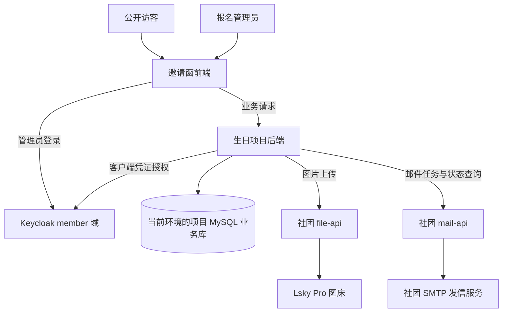
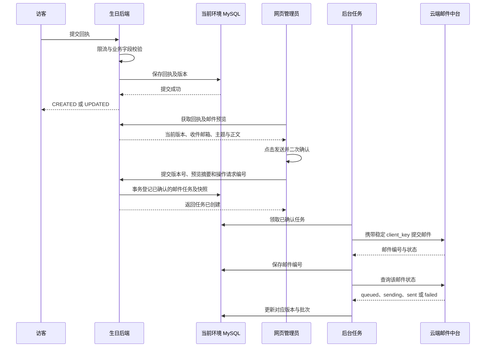
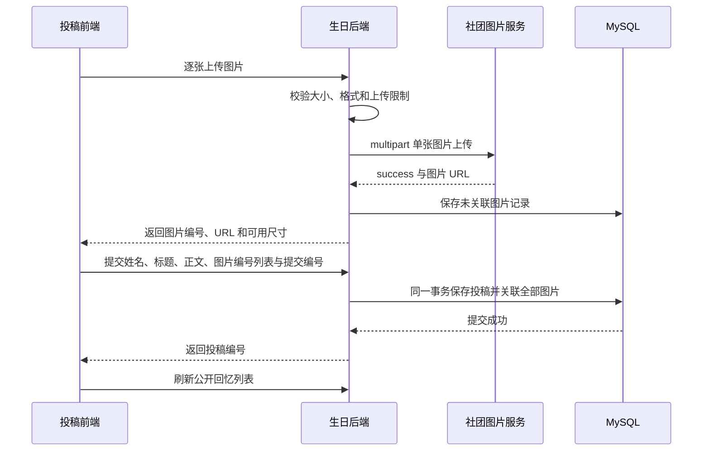
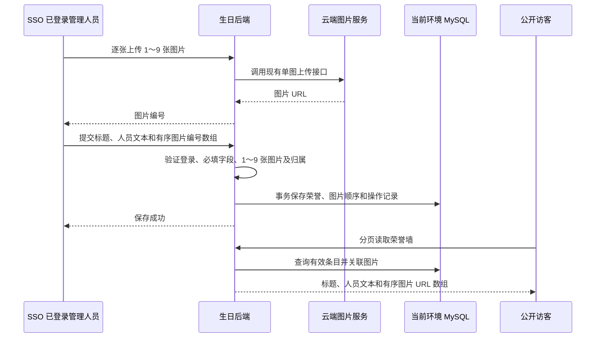

# 社团十六周年邀请函项目需求规格与实现链路

版本为 v2.4，更新日期为 2026-11-22。

本文是今年新项目的功能需求与接入基线，依据本次讨论、用户提供的 OpenAPI 1.1.0、React 模板、社团既有服务和线上联调结果整理。v1.5 将荣誉墙确定为每条填写标题、1～9 张图片与人员三个必填业务字段，人员由管理员直接输入姓名文本，相关接口和数据库按此简化。管理员已进入实际实现，新功能以文末v2补充为准。

## 1. 目标与范围

为历届学长学姐提供邀请回执填写入口，收集到场意向与礼物领取方式，保留回忆投稿和公开展示能力，以标题、图片和人员姓名展示社团荣誉，并通过网页后台管理报名与荣誉条目。

### 1.1 已确认功能

| 模块 | 确认范围 |
| --- | --- |
| 邀请回执 | 提交、按手机号更新、字段与跨字段校验、提交结果反馈 |
| 网页报名管理 | Keycloak SSO 登录成功即可管理，提供分页查询、搜索、筛选、统计、导出、更正回执、手动发送和重发邮件 |
| 确认邮件 | 管理员点击并二次确认后调用社团邮件 API，查询状态和处理失败 |
| 回忆投稿 | 文字与图片投稿，成功提交后直接展示 |
| 回忆墙 | 分页列表、投稿详情、多图查看 |
| 荣誉墙 | 公开展示标题、1～9 张图片与人员文本，三个字段均必填 |
| 荣誉管理 | SSO 登录成员添加、编辑、删除荣誉条目，表单仅含标题、图片和人员文本 |
| 图片存储 | 复用社团 file-api 与 Lsky Pro 图床 |
| 数据存储 | 开发直连云上 MySQL 的16th_birthday独立库与项目账号；自动化测试仍用本机独立测试库，生产发布另行配置 |
| 应用交付 | 沿用去年方式，前端 Nginx 静态镜像和后端 Java JAR 镜像分别交付 |

### 1.2 本次范围决策

| 内容 | 最终决策 |
| --- | --- |
| 飞书多维表格同步与管理 | 已移出项目范围 |
| 投稿审核 | 已移出项目范围，投稿保存成功后公开 |
| 小游戏 | 已移出项目范围 |
| 活动时间、地点、具体礼物内容、报名截止时间的配置与展示 | 已移出项目范围 |
| 开场动画、背景音乐、页面美化 | 留待前端视觉设计阶段讨论 |
| 生产基础设施 | MySQL、图床、邮件中台均复用已有服务，开发数据库允许直连云上16th_birthday |

礼物选择字段继续保留“不需要、现场领取、邮寄”，用于处理回执与邮寄安排。

### 1.3 设计状态说明

用户于 2026-11-21 确认本文既有建议中符合最新决策的内容默认可执行。本版功能和默认值作为实施基线，账号、域名、端口和外部服务能力通过配置与联调落实。

原 OpenAPI 1.1.0 是基础参考。用户最新决策优先，开发时同步更新手机号、到场枚举、管理鉴权、邮件状态和新增接口。

### 1.4 开场独立与公开页面（2026-11-22最新）

公开路径现为开场占位/、首页/invitation、回忆墙/memories、荣誉墙/honors、115编年史/chronicle。开场与填写页分开；首页展示循环粒子与欢迎文案，下方放回执和可选投稿两张独立表单。开场动画和结束跳转暂不开发；回忆完整详情在墙内小卡展示，不再单独详情页。投稿不要求先报名成功。

| 区域 | 最新适配要求 |
| --- | --- |
| 公开手机视图 | 独立手机展示；窄屏占满，容器与内容弹层沿用最大450px尺度 |
| 公开电脑视图 | 独立桌面展示与自适应宽度，不再套用450px手机框 |
| 管理后台 | 继续现有桌面布局，不因公开双端改造改变 |
| 业务逻辑 | 同一项目/路由/API/规则/提交状态，只有展示与交互分为两套 |

电脑回忆卡片悬停或键盘聚焦展示完整详情，手机点击展开；纯文字投稿也有触发区域。荣誉悬停展示人员姓名文本，手机点触可查看；不关联人员资料页。触屏电脑同样提供点击兜底，不能只依赖hover。

切换视口不得丢回执、投稿或上传状态，不重开播放器、不重复发请求；两份表单独立，由稳定首页控制器持有。两套视觉的具体排版、配色、动画和音乐仍待设计，本次只改规划。

## 2. 使用角色与权限

| 身份 | 可执行操作 |
| --- | --- |
| 公开访客 | 查看邀请页、填写回执、查看回忆墙、投稿、浏览荣誉标题、图片和人员姓名 |
| 已登录社团成员 | 通过 member 域 SSO 登录后，执行报名管理与荣誉条目维护 |
| 后端邮件服务账号 | 获取应用令牌，调用社团邮件 API 并查询任务状态 |

社团现有成员管理负责成员资格和账号管理。管理访问以成功完成 SSO 登录且持有有效用户令牌为依据。

公开入口免登录。前端提供登录守卫，后端验证用户令牌签名、签发者、有效期和配置的受众。管理员身份判定采用 SSO 认证结果。

邮件服务账号继续需要邮件中台要求的 Realm 角色 `mail`，用于后端调用外部邮件服务。

## 3. 总体架构与数据归属



| 信息 | 归属与保存位置 |
| --- | --- |
| 报名、投稿、荣誉条目及图片关联 | 开发使用共享MySQL的16th_birthday独立库；生产发布按明确配置接入项目业务库 |
| 图片文件 | 社团现有图床 |
| 用户身份与角色 | 现有 Keycloak |
| 邮件正文、发送队列、发送日志 | 社团 mail-api |
| 回执版本、管理员确认后的邮件任务、外部邮件编号和状态摘要 | 当前环境的生日项目业务库 |

网页后台经项目后端查询业务库。开发和生产均可连接现有云端 SSO、图床和邮件 API。邮件中台使用的 PostgreSQL、Redis 由基础设施维护方管理。

## 4. 报名回执

### 4.1 输入字段

| 字段 | 类型 | 规则 |
| --- | --- | --- |
| `name` | string | 必填，去除首尾空白后长度为 1～50 |
| `phone` | string | 必填，去除首尾空白后为 11 位大陆手机号，按 `^1[3-9][0-9]{9}$` 校验 |
| `email` | string | 必填，校验邮箱格式，最多 254 字符 |
| `attendance` | enum | 必填，`ATTENDING` 到场、`NOT_ATTENDING` 不到场 |
| `giftChoice` | enum | 必填，`NONE`、`PICKUP`、`MAIL` |
| `mailingAddress` | string/null | `MAIL` 时去除首尾空白后不能为空，最多 500 字符；其他选择应为空或省略 |

| 到场状态 | 不需要 `NONE` | 现场领取 `PICKUP` | 邮寄 `MAIL` |
| --- | --- | --- | --- |
| 到场 `ATTENDING` | 允许 | 允许 | 允许 |
| 不到场 `NOT_ATTENDING` | 允许 | 禁止 | 允许 |

选择不到场时，前端礼物选项只展示不需要和邮寄，并清理失效的现场领取选择。切换回到场后恢复现场领取选项。切换为非邮寄方式时，清理邮寄地址。后端独立执行相同校验，并拒绝不合法组合与未知请求字段。

### 4.2 手机号与重复提交

1. 去除首尾空白后校验 11 位大陆手机号，以校验通过的 11 位号码保存和识别报名人。
2. 手机号建立唯一约束，并发提交通过事务与唯一约束保持一人一条。
3. 同一号码再次提交时更新原记录，业务内容变化时递增回执版本，该版本邮件初始状态为 `NOT_SENT`。
4. 完全相同内容重复提交返回 `UPDATED`，复用现有版本与邮件状态，`submittedAt` 表示本次处理时间。
5. 首次报名、访客更新和管理员更正都只保存回执，由管理员决定是否发送邮件以及何时点击确认。
6. 历史邮件记录独立保留，后台同时展示当前版本状态与历史发送批次。

访客重新填写整份回执即可更新报名，提交另一个手机号时按新号码识别报名人。

### 4.3 保存回执与手动发信链路



回执保存与确认发送是独立操作。管理员确认时持久化确认人、确认时间、回执版本、邮件快照和发送任务，后台在事务提交后调用中台。管理员实际点击确认的时间决定任务开始处理的时机。

### 4.4 用户反馈与限流

- 请求处理中展示提交状态，防止连续点击。
- 数据库事务成功后展示首次报名成功或回执更新成功。
- 报名成功后提示回执已保存，邮件由管理员后续确认发送。
- 字段错误定位到具体输入项。网络失败保留已填内容以便重试。
- 公开回执接口默认按客户端 IP 每分钟限制 10 次，支持配置调整。
- 超限返回 HTTP 429 与 `Retry-After`。部署后仅信任受控反向代理提供的客户端 IP。

## 5. 网页报名管理

### 5.1 登录和鉴权

1. 管理员进入管理入口，前端检查现有 Keycloak 登录状态。
2. 未登录时跳转 Keycloak，使用授权码流程与 PKCE S256 完成登录。
3. 登录成功后返回管理页面，前端获取访问令牌。
4. 管理请求携带 `Authorization: Bearer <access_token>`。
5. 后端验证用户令牌签名、签发者、有效期和配置的受众，认证通过即可管理。
6. 未认证或令牌失效返回 401，前端处理刷新或重新登录。成员资格由社团现有 SSO 成员管理负责。

前端使用模板已有的 `keycloak-js` 封装作为接入基础。模板目前是登录和业务框架，生日业务页面及权限闭环仍待实现。

原 OpenAPI 的静态 `ADMIN_TOKEN` 鉴权方案调整为 Keycloak 用户令牌。此处是已确认的接口认证变更，需要更新接口文档。

### 5.2 查询、筛选和导出

| 功能 | 规则 |
| --- | --- |
| 分页 | 页码从 1 开始，默认每页 20，最多 100 |
| 排序 | 按更新时间倒序，同时间使用记录编号稳定排序 |
| 状态筛选 | 支持到场状态、礼物选择 |
| 关键词 | 对姓名、手机号或邮箱执行模糊搜索，最多 100 字符 |
| 显示字段 | 姓名、电话、邮箱、到场状态、礼物、邮寄地址、邮件状态、创建和更新时间 |
| CSV 导出 | 应用与列表相同的筛选条件，导出全部匹配记录 |

CSV 使用 UTF-8 并兼容常见表格软件，正确转义逗号、引号和换行，处理可能被识别为公式的单元格值。

### 5.3 统计

提供总报名人数，到场、不到场人数，不需要礼物、现场领取、邮寄人数，有效邮寄地址数量，以及最新回执版本的邮件状态分布。

统计按唯一报名人计算。原 OpenAPI 的统计接口没有筛选参数，第一版按全量记录汇总。到场统计只含 `attending`、`notAttending`，邮件统计新增 `notSent`，区分未确认发送与处理中。

### 5.4 更正回执与手动邮件操作

- 管理员可更正姓名、邮箱、到场状态、礼物及地址，执行相同业务校验并记录操作人，手机号继续作为识别值。
- 每条回执提供首次发送或再次发送操作，并展示当前版本的发送状态和历史批次。
- 点击后预览收件邮箱、主题和正文，二次确认后创建任务。
- 确认携带回执版本与操作请求编号，重复请求返回已有任务。
- 预览后回执版本或邮件内容摘要改变时返回 409，刷新预览并重新确认。
- 已发送或最终失败的记录可再次手动发送，每次新的确认建立新批次。
- 已在处理中的任务展示进度，重复点击复用该任务。

## 6. Keycloak 配置

### 6.1 共用参数

| 配置项 | 值 |
| --- | --- |
| 服务地址 | `https://sso.sipc115.com` |
| Realm | `member` |
| Issuer | `https://sso.sipc115.com/realms/member` |
| Token endpoint | `https://sso.sipc115.com/realms/member/protocol/openid-connect/token` |

### 6.2 网页客户端 birthday-web

| 能力 | 配置 |
| --- | --- |
| Client type | OpenID Connect |
| Client authentication | Off |
| Standard flow | On |
| PKCE | 前端使用 S256，建议客户端同时要求 S256 |
| Direct access grants、Implicit flow、Service accounts roles | Off |
| Authorization、Device Authorization、CIBA | Off |
| Always display in UI | Off |

当前本地开发地址约定为 `http://127.0.0.1:5173`，同时允许 `http://localhost:5173`。

| 登录设置 | 当前约定值 |
| --- | --- |
| Root URL、Home URL | `http://127.0.0.1:5173` |
| Valid redirect URIs | `http://127.0.0.1:5173/*`、`http://localhost:5173/*`，分别添加 |
| Valid post logout redirect URIs | `http://127.0.0.1:5173/*`、`http://localhost:5173/*`，分别添加 |
| Web origins | `http://127.0.0.1:5173`、`http://localhost:5173`，分别添加 |

正式域名待确认，上线前补齐正式域名对应的设置。客户端已从用户截图确认创建，实际登录与注销闭环仍待联调。

### 6.3 邮件客户端 birthday-api-mail

| 能力 | 配置 |
| --- | --- |
| Client authentication | On |
| Service accounts roles | On |
| Standard flow、Direct access grants、Implicit flow | Off |
| Authorization、Device Authorization、CIBA | Off |
| 登录回调和 Web origins | 留空 |
| 服务账号角色 | Realm 级别的 `mail` |
| 授权方式 | `client_credentials` |

角色必须实际进入签发令牌的 `realm_access.roles`。`birthday-mail` 与邮件服务要求的 `mail` 是不同角色。该客户端获取令牌并通过邮件接口鉴权已完成线上验证。

Client Secret 通过后端环境配置提供。前端使用公开客户端。网页管理依据 SSO 用户认证结果，邮件中台依据服务账号的 `mail` 角色授权。

## 7. 社团邮件服务接入

### 7.1 服务能力

基础地址为 `https://services.sipc115.com/mail-api`。

| 方法 | 路径 | 用途 |
| --- | --- | --- |
| GET | `/healthz` | 健康检查，免鉴权 |
| POST | `/api/v1/mails` | 创建单封邮件任务 |
| GET | `/api/v1/mails/{id}` | 查询任务和事件日志 |

邮件中台当前基于飞书企业邮箱 SMTP 发送，包含 PostgreSQL 持久化队列、工作器、指数退避重试、卡死任务回收、`client_key` 幂等和事件日志。生日项目接入这些既有能力。

### 7.2 发信请求

```json
{
  "to": [
    "alumni@example.com"
  ],
  "subject": "社团十六周年邀请函回执确认",
  "text": "已收到您的回执。姓名、到场选择和礼物选择见本次确认内容。",
  "html": "<p>已收到您的回执。</p>",
  "client_key": "birthday16:production:invitation:1024:v2:send1"
}
```

新任务一般返回 HTTP 202，响应字段为 `data.id`、`data.status`、`data.status_query`。相同 `client_key` 可能返回 HTTP 200 和已有任务，调用方均应识别为已受理。

1. 后台领取管理员已确认的邮件任务，读取该版本的邮件快照。
2. 使用客户端凭证获取或复用 Keycloak 令牌，根据返回有效期在到期前更新。
3. 以固定 `client_key` 调用单封发信接口。
4. 保存返回的邮件编号后转入状态查询。
5. 查询结果从 `data.mail` 读取状态，`data.logs` 提供事件时间线。

### 7.3 状态映射与含义

| 外部状态或本地情况 | 对外 `emailNotifyStatus` | 含义 |
| --- | --- | --- |
| 当前版本尚无管理员确认的任务 | `NOT_SENT` | 未发送，等待管理员操作 |
| 已确认并等待调用、`queued`、`sending` | `PENDING` | 正在处理 |
| `sent` | `SUCCESS` | SMTP 发送成功 |
| `failed` 或不可恢复的调用失败 | `FAILED` | 保存失败原因，供管理员查看 |
| 环境配置关闭发送 | `DISABLED` | 当前环境禁用实际发信 |

`SUCCESS` 在本项目中表示 SMTP 发送成功。最终送达、垃圾箱归类和收件人阅读状态超出现有 API 已确认能力。后台文案使用“已发送”，`emailNotifiedAt` 取该发送任务的 `sent_at`。

新回执版本处于 `NOT_SENT` 时，当前版本的 `emailNotifiedAt` 为空，历史批次的发送时间继续保留。

### 7.4 手动发送规则与一致性

- 首次报名、访客更新、管理员更正均只保存回执，管理员点击发送并二次确认才创建可执行任务。
- 邮件包含姓名、到场选择、礼物选择和回执编号。
- 确认请求携带 `expectedVersion`、`requestId` 与 `previewHash`，后端核对版本和预览内容摘要，事务保存确认人、时间、快照及任务。
- 操作请求编号建立唯一约束，重复点击或网络重试返回原任务。
- `client_key` 包含项目、环境、报名编号、业务版本和发送批次，同一批次重试保持一致。
- 管理员已确认的任务遇到临时网络故障时，可自动重试并展示进度。
- 受理结果未知时，以同一 `client_key` 重试并取得原邮件编号，已受理任务由中台执行 SMTP 重试。
- 用户更新回执后，旧任务只更新对应的历史记录，当前新版本显示 `NOT_SENT`。
- 已确认的旧版本任务尚未交给中台时，检测到版本变化应取消该次调用并说明原因，由管理员重新确认当前版本。已被中台受理的任务按现有编号继续跟踪。
- HTTP 401 可刷新令牌重试一次，403 记录配置或角色问题，429 和暂时性网络故障采用退避重试。
- 状态查询临时失败时保留已知状态及查询错误，恢复后继续查询。
- 手动再次发送建立新批次与新 `client_key`，记录操作者和确认时间。
- 服务重启后恢复已确认的待调用与待查询任务，采用数据库原子领取和可恢复占用期限。

本轮发送时机由管理员手动确认控制，已确认任务继续通过后台执行与中台 SMTP 重试完成。

### 7.5 联调结论

2026-11-20 已验证客户端凭证授权、`mail` 角色、受保护 API 调用、邮件创建和状态查询。

测试邮件任务编号为 `7138a5aa-7505-44cd-8e5e-846fb44a1f01`。中台返回 202 并入队，5 次 SMTP 尝试均报告 `SMTP 发送超时(2m0s)`，最终为 `failed`。用户已明确由社团维护方处理邮件中台故障，生日项目按已验证链路实现。

## 8. 回忆投稿与图片链路

### 8.1 投稿字段与展示规则

| 字段 | 规则 |
| --- | --- |
| 展示姓名 | 可选，去除首尾空白，最多 50 字；为空时按匿名展示 |
| 标题 | 选填，最多 100 字 |
| 正文 | 选填，最多 5000 字 |
| 图片 | 最多 9 张，图片与非空正文至少提供一项 |
| 发布时间 | 由后端生成 |

投稿可独立于报名进行。投稿提交成功后直接公开，无审核状态和审核操作。公开列表和详情只返回投稿展示字段。正文按文本安全渲染，用户输入作为内容处理。

### 8.2 图床接口

基础地址为 `https://services.sipc115.com/file-api`。

| 方法 | 路径 | 请求与返回 |
| --- | --- | --- |
| GET | `/healthz` | 健康检查 |
| POST | `/api/v1/images` | `multipart/form-data`，单张图片字段为 `file`，成功读取 `success` 和 `url` |

现有文档默认限制单张 10 MB、2500 万像素。JPEG、PNG、WebP 会压缩和缩放，GIF 保持原文件。实际生产限制以服务配置和响应为准。项目首版采用上述四种格式及 10 MB 单图上限。

图床调用凭证由 file-api 内部维护，目前已验证上传入口跨域预检正常、已有图片可读。实际上传仍待端到端验证。

### 8.3 上传与发布步骤



- 单张上传失败时提供单图重试，已成功图片复用返回结果。
- 使用本项目生成的图片编号关联投稿，后端验证图片存在、允许关联且数量合法。
- 投稿使用稳定的提交编号去重，网络重试返回已有投稿。
- 按前端提交的图片顺序保存关联。
- 优先使用图片服务返回的实际尺寸；缺少尺寸时允许为空，由前端在图片加载后完成布局。
- 所有待提交图片均上传成功后，再提交完整投稿。图片上传成功与投稿发布成功分别反馈。
- 现有 file-api 源码没有暴露删除接口。未关联上传记录可以在本项目中标识，远端物理清理需要社团服务提供对应能力，当前不承诺自动删除。

### 8.4 回忆墙读取

- 列表默认按发布时间和编号倒序分页，首次加载、继续加载和空列表都有明确反馈。
- 列表返回姓名、标题、正文摘要、封面图、图片数量和发布时间。
- 完整详情接口仍返回正文与有序图片，前端在墙内悬停/点触小卡展示，不另建详情页面。
- 投稿成功后将新记录展示在列表顶部，读取失败提供重试。
- 页码从 1 开始，每页默认 20，最大 50，按稳定倒序分页。

## 9. 荣誉墙

### 9.1 三个必填业务字段

| 字段 | 规则 |
| --- | --- |
| 标题 title | 必填，去除首尾空白后长度为 1～100 字 |
| 图片 imageIds | 必填，有序图片编号数组，每条至少 1 张、最多 9 张，单张沿用 10 MB 上限 |
| 人员 people | 必填，由管理员直接填写姓名文本，去首尾空白后 1～200 字，可填写多个姓名 |

添加和编辑表单展示标题、人员文本输入和最多 9 张图片上传，支持调整顺序。人员姓名直接存入荣誉条目，可用顿号分隔多个姓名。编号、时间、版本和删除标记由系统维护。

### 9.2 公开展示

- 公开列表展示每条荣誉的标题、图片和管理员填写的人员文本。
- 手机端沿用最大450px，电脑端使用独立自适应视图。\n- 电脑悬停/聚焦显示人员文本，手机点触可查看，不新增人员资料页。
- 首图作为封面，图片可点击放大，按保存顺序查看该条目的全部图片。
- 按创建时间与编号倒序分页，每页默认 20、最多 50。
- 提供加载、空列表和请求失败重试反馈。

### 9.3 后台维护

- SSO 登录成员可添加、编辑和删除荣誉条目。
- 新增时上传 1～9 张图片并填写标题和人员，三个字段均合法后保存。
- 编辑时可修改标题、人员文本，以及增加、删除、替换和排序图片；保存时至少保留 1 张，保存后更新公开展示。
- 标题或人员为空、仅含空白、超过长度限制，或图片为空、超过 9 张、编号无效或重复时返回字段错误。
- 创建使用操作请求编号去重，编辑和删除携带 expectedVersion，冲突返回 409。
- 删除前二次确认，后端软删除，公开列表随之更新。
- 替换或删除条目后，图片物理清理遵循现有图床接口能力。

### 9.4 保存与读取链路



## 10. 项目接口约定

业务接口采用 `/api/v1` 前缀。完整路径、字段、统一响应、分页和代码字典见 [API 接口文档](API接口文档.md)。本项目 JSON 响应固定包含 code、message、data、fieldErrors、traceId，业务数据放在 data，BIGINT 编号和版本序列化为字符串。CSV 成功响应为文件。社团图片和邮件服务由项目后端适配。

### 10.1 原 OpenAPI 基础接口

| 方法 | 路径 | 鉴权 | 返回 |
| --- | --- | --- | --- |
| POST | `/api/v1/invitations` | 公开 | 首次 201，更新 200 |
| GET | `/api/v1/admin/invitations` | Keycloak 管理员 | 报名分页数据 |
| GET | `/api/v1/admin/invitations/export` | Keycloak 管理员 | CSV 文件 |
| GET | `/api/v1/admin/invitations/stats` | Keycloak 管理员 | 全量汇总 |
| GET | `/api/v1/health` | 公开 | 应用运行状态 |

回执提交响应的 data 包含 `id`、`result`、`submittedAt`。列表响应的 data 固定包含 `content`、`page`、`size`、`totalElements`、`totalPages`。统计响应保留 `total`、`attendance`、`gifts`、`email`、`mailingAddressCount`，其中 `attendance` 只含 `attending`、`notAttending`，`email` 新增 `notSent`。邮件状态枚举新增 `NOT_SENT`。

### 10.2 新增业务接口

| 方法 | 路径 | 用途 |
| --- | --- | --- |
| POST | `/api/v1/media/images` | 上传单图并返回图片编号 |
| POST | `/api/v1/memories` | 提交投稿与图片关联 |
| GET | `/api/v1/memories` | 分页读取公开回忆 |
| GET | `/api/v1/memories/{id}` | 投稿详情 |
| PATCH | `/api/v1/admin/invitations/{id}` | 更正回执，携带 expectedVersion |
| GET | `/api/v1/admin/invitations/{id}/email-preview` | 获取当前版本邮件预览 |
| POST | `/api/v1/admin/invitations/{id}/email-sends` | 确认首次或再次发送 |
| GET | `/api/v1/admin/invitations/{id}/email-sends` | 查询邮件历史与状态 |

发送请求包含 `expectedVersion`、`requestId`、`previewHash`，后端核对预览摘要，返回本地任务编号、回执版本和任务状态。中台受理后记录外部邮件编号。首次发送与再次发送统一使用发送接口和不同确认批次。

限流默认值由 API 契约统一确定，报名每 IP 每分钟 10 次，投稿每 IP 每分钟 5 次，匿名上传每 IP 每分钟 20 次，登录上传每 SSO sub 每分钟 60 次，支持配置调整。

### 10.3 荣誉墙接口

| 方法 | 路径 | 用途 |
| --- | --- | --- |
| GET | `/api/v1/honors` | 公开分页列表，包含编号、标题、人员文本、封面及有序图片 URL 数组 |
| GET | `/api/v1/admin/honors` | 后台分页管理列表 |
| GET | `/api/v1/admin/honors/{id}` | 读取当前编辑值及版本 |
| POST | `/api/v1/admin/honors` | 创建荣誉，业务字段为 title、imageIds、people |
| PATCH | `/api/v1/admin/honors/{id}` | 编辑标题、图片或人员文本 |
| DELETE | `/api/v1/admin/honors/{id}` | 删除荣誉 |

公开查询免登录，管理接口使用与报名后台相同的 SSO 认证。管理命令携带 requestId，编辑和删除同时携带 expectedVersion。删除参数放在 query，其他命令放在 JSON，用于幂等和并发控制。

title、people 和 imageIds 均必填。创建或图片编辑时，imageIds 长度须为 1～9，编号不得重复。后端在同一事务保存完整图片关联，失败整体回滚。

公开列表只接受 page、size 分页参数。图片上传继续使用已有 `POST /api/v1/media/images`。

### 10.4 回执请求与返回示例

```json
{
  "name": "示例姓名",
  "phone": "13800138000",
  "email": "alumni@example.com",
  "attendance": "NOT_ATTENDING",
  "giftChoice": "MAIL",
  "mailingAddress": "示例邮寄地址"
}
```

```json
{
  "code": "INVITATION_CREATED",
  "message": "回执已保存",
  "data": {
    "id": "1024",
    "result": "CREATED",
    "submittedAt": "2026-11-20T20:00:00+08:00"
  },
  "fieldErrors": {},
  "traceId": "d58a80ad-84e2-4ad6-91e2-8dc40e0e1431"
}
```

### 10.5 错误结构

```json
{
  "code": "VALIDATION_ERROR",
  "message": "请检查填写内容",
  "data": null,
  "fieldErrors": {
    "mailingAddress": "选择邮寄时必须填写地址"
  },
  "traceId": "d58a80ad-84e2-4ad6-91e2-8dc40e0e1431"
}
```

| HTTP 状态 | 用途 |
| --- | --- |
| 400 | 参数格式、字段或跨字段校验错误 |
| 401 | 管理请求未认证或令牌无效 |
| 404 | 投稿或管理记录不存在 |
| 409 | 回执、邮件预览、荣誉版本或图片关联冲突 |
| 413 | 上传超过大小限制 |
| 429 | 超出请求频率限制 |
| 500 | 服务器内部错误 |
| 502/503 | 图片上游错误或暂时不可用 |

回执主体保存成功后，邮件上游失败通过邮件状态表达。前端按 HTTP 状态和 `message`、`fieldErrors` 展示结果。新增错误码及接口字段需要补入 OpenAPI。

## 11. 数据模型

完整物理表、字段、索引、外键、事务和 SQL 见 [数据库设计](数据库设计.md)。

| 表 | 作用 |
| --- | --- |
| invitations | 报名回执与当前版本 |
| email_notifications | 管理员确认后的邮件批次、调用任务及状态历史 |
| media_images | 图片上传结果与关联依据 |
| memories | 公开回忆投稿 |
| memory_images | 回忆图片及顺序 |
| honor_entries | 荣誉标题与人员文本，图片通过 honor_images 关联，三个业务字段均必填 |
| honor_images | 荣誉图片编号和展示顺序，单条最多 9 张 |
| admin_operation_logs | 管理操作记录 |
| idempotency_requests | 管理命令幂等结果 |

荣誉条目通过 honor_images 有序关联 media_images，一条荣誉至少 1 张、最多 9 张图片。人员直接作为 people 文本保存。系统自动维护主键、版本、创建修改时间、操作人和软删除标记。

管理员更正、邮件确认及荣誉增删改记录操作人、目标记录、动作与时间。外部图片、邮件调用安排在数据库事务外执行。

## 12. 基础设施与部署

### 12.1 既有服务

| 服务 | 接入地址 | 已验证情况 |
| --- | --- | --- |
| 共享 MySQL | `192.168.115.23:3308` | 已登录并执行只读查询，实际版本 8.1.0 |
| Keycloak | `https://sso.sipc115.com` | member 域可访问，邮件客户端授权与角色已验证 |
| 图片 API | `https://services.sipc115.com/file-api` | 健康检查、预检和已有图片读取正常 |
| 图床 | `https://image.sipc115.com` | 已有图片读取正常 |
| 邮件 API | `https://services.sipc115.com/mail-api` | 健康、鉴权、入队及查询正常，SMTP 故障由社团维护方处理 |

用户已授权开发直连共享MySQL，并创建16th_birthday独立库和项目账号；生产发布时显式配置业务库与账号。自动化测试保持本机birthday16_test，不对云库执行测试清理。

生产应用容器需要具备共享 MySQL 内网路由，开发与生产均需要访问 SSO、图片 API、邮件 API 与图片资源域名。内网直连 `16682`、`16683` 的测试未成功，接入优先使用已验证的 HTTPS 网关。

### 12.2 去年交付证据与今年继承方案

| 组件 | 去年仓库实现 | 今年采用方式 |
| --- | --- | --- |
| 前端构建 | Vite 构建静态文件到 dist | React SPA 构建静态产物，打包为 Nginx 镜像 |
| 前端运行 | nginx:alpine-slim，复制静态目录和 default.conf | 静态页面与 API 反向代理 |
| SPA 路由 | try_files 回退到 index.html | 支持管理路由与 SSO 回调直接访问和刷新 |
| API 代理 | /api 转发至后端，旧地址为 172.18.0.1:16620 | 使用今年部署确定的可达地址，保留 /api 请求路径 |
| 后端构建 | Maven 产出可执行 Spring Boot JAR | 沿用 Java、Spring Boot 可执行 JAR 交付 |
| 后端运行 | Java 17 镜像，java -jar，暴露 16620 | 后端独立 Docker 镜像，端口按部署配置确定 |

去年仓库有前后端 Dockerfile，未发现 Compose 或 CI/CD 发布脚本。代码证据确认“前端静态 Nginx 镜像＋后端 JAR 镜像”，具体历史发布命令、镜像仓库和自动化平台仍待部署时落实。

今年交付两个独立 Docker 镜像，运行环境负责镜像版本、端口、网络和环境配置。前端与后端分别部署。

后端工程结构按用户提供的 Java Web 模板规划，按用户最新决定采用 Java 21，Spring Boot 沿用模板的 4.1.2，详细文件树与实现说明见 [后端项目结构与实现说明](后端项目结构与实现说明.md)。上述 Java 17 属于去年交付证据。

当前前端已采用新模板的数据路由与Vite浏览器渲染，产物为web/dist。前端运行层为静态资源服务；Docker内构建还是先构建dist再封装仍待选择，不沿用旧Framework的build/server运行方式。

### 12.3 开发与生产

| 配置 | 开发 | 生产 |
| --- | --- | --- |
| 前端 | 本机开发服务器，约定 5173 | Nginx 静态镜像 |
| 后端 | 本机运行，直连云上16th_birthday | Java 后端镜像 |
| 数据库 | 共享 MySQL 的16th_birthday独立库和仅DML账号 | 发布时显式配置项目业务库和账号 |
| SSO | 云端 member 域，本机回调 | 同一 SSO，补齐正式域名回调 |
| 图片 | 云端 file-api 与图床 | 同一服务 |
| 邮件 | 云端 mail-api，手动确认后可实际发信 | 同一服务，手动确认发信 |

开发连接已切换为`192.168.115.23:3308/16th_birthday`，使用TLS，正常开发产生的数据保存到该云库。自动化集成测试固定`127.0.0.1:3306/birthday16_test`，使用单独TEST_DB_*凭据；旧本机开发库保留。新云库执行完整schema脚本，未来变更按迁移管理。

### 12.4 环境配置

以下命名作为实施约定，按后端框架配置机制接入。

开发数据库示例如下。

```dotenv
APP_ENV=development
DB_HOST=192.168.115.23
DB_PORT=3308
DB_NAME=16th_birthday
DB_USER=birthday16_app
DB_PASSWORD=<本地忽略配置中的云库账号密码>
DB_SSL_MODE=REQUIRED
TEST_DB_USER=<本机测试账号>
TEST_DB_PASSWORD=<本机测试密码>
```

生产数据库示例如下。

```dotenv
APP_ENV=production
DB_HOST=192.168.115.23
DB_PORT=3308
DB_NAME=<生产业务库>
DB_USER=<生产项目账号>
DB_PASSWORD=<部署环境注入>
```

外部服务配置如下。

```dotenv
KEYCLOAK_URL=https://sso.sipc115.com
KEYCLOAK_REALM=member
ADMIN_API_AUDIENCE=<部署时确认>
MAIL_CLIENT_ID=birthday-api-mail
MAIL_CLIENT_SECRET=<本地或部署环境注入>
MAIL_API_BASE_URL=https://services.sipc115.com/mail-api
FILE_API_BASE_URL=https://services.sipc115.com/file-api
EMAIL_ENABLED=true
RATE_LIMIT_REQUESTS_PER_MINUTE=10
```

前端配置如下。

```dotenv
VITE_KEYCLOAK_URL=https://sso.sipc115.com
VITE_KEYCLOAK_REALM=member
VITE_KEYCLOAK_CLIENT_ID=birthday-web
VITE_API_BASE_URL=/api
```

前端统一拼接规则，最终请求 `/api/v1/...`，开发服务器和生产 Nginx 各自代理到对应后端。

日志包含请求编号、邮件编号和必要错误摘要，凭证由受控环境配置提供。应用具备运行检查、外部请求超时和已确认任务恢复能力。

待落实配置包括镜像仓库、生产域名、宿主机端口、Docker 网络、项目账号、数据库迁移及备份安排。

## 13. 验收场景

| 编号 | 场景 | 预期 |
| --- | --- | --- |
| A01 | 首次合法报名 | 201、CREATED，保存记录，邮件为 NOT_SENT |
| A02 | 同一大陆手机号修改回执 | 200、UPDATED，总人数不增加，新版本为 NOT_SENT |
| A03 | 相同内容重复或并发提交 | 一人一条，复用版本与该版本邮件状态 |
| A04 | 前端选择不到场 | 礼物只显示不需要和邮寄，失效选择被清理 |
| A05 | 请求不到场且现场领取 | 400 与字段提示 |
| A06 | 地址、手机号、邮箱、长度或到场枚举非法 | 400 与字段提示，到场有效值只有 ATTENDING 和 NOT_ATTENDING |
| A07 | 报名限流 | 429 与 Retry-After |
| A08 | SSO 登录和注销 | 有效用户登录后可管理，注销后重新认证 |
| A09 | 未认证或令牌无效 | 管理接口返回 401 |
| A10 | 搜索、筛选、分页、导出 | 条件一致、排序稳定、CSV 可打开 |
| A11 | 统计 | 到场两种状态，邮件区分未发送、处理中、成功、失败和禁用 |
| A12 | 管理员更正 | 相同业务校验，记录操作人，更正后待管理员确认发信 |
| A13 | 预览后确认发送 | 保存确认记录和任务，状态可查询 |
| A14 | 预览版本已变化 | 409，刷新后重新确认 |
| A15 | 发送确认重复请求 | 复用本地任务与中台邮件 |
| A16 | 管理员再次发送 | 新确认产生新批次，历史可查 |
| A17 | 中台失败或应用重启 | 报名有效，已确认任务可恢复 |
| A18 | 匿名文本、仅图或带姓名标题投稿 | 正文或图片至少一项即可，姓名标题均可空 |
| A19 | 空投稿或非法图片 | 返回错误，保留可重试内容 |
| A20 | 图片部分失败 | 单图可重试，完整投稿尚未发布 |
| A21 | 投稿请求重试 | 返回原投稿，避免重复发布 |
| A22 | 云端图片完整上传 | 图片可读、关联成功，投稿直接公开 |
| A23 | 开发接入 | 写入云上16th_birthday独立库，图床和邮件使用云端；集成测试只写本机测试库 |
| A24 | 生产交付 | Nginx 提供页面与 API 代理，JAR 容器接生产业务库 |
| A25 | SMTP 恢复后手动发信 | 中台 sent，项目 SUCCESS |
| A26 | 公开页面在手机与电脑访问 | 小屏占满可用宽度，电脑端以最大 450px 容器居中展示，投稿与详情弹层遵循相同宽度约束 |
| A27 | 管理后台在电脑浏览器访问 | 页面随桌面窗口可用宽度自适应，统计、表格及操作区域正常布局 |
| A28 | 荣誉必填校验 | 标题或人员为空、仅含空白，或图片为空、超过 9 张、无效或重复时保存失败并提示字段错误 |
| A29 | 公开荣誉展示 | 每条展示标题、1～9 张图片和人员文本，支持分页和图片放大 |
| A30 | 荣誉后台维护 | SSO 登录成员可新增、编辑和删除，未登录请求返回 401 |
| A31 | 荣誉请求重试及并发修改 | 创建去重，编辑和删除版本冲突返回 409 |
| A32 | 荣誉删除和图片替换 | 公开列表正确更新，数据库图片引用保持完整 |
| A33 | 荣誉多图边界与顺序 | 1 张和 9 张均可保存，0 张、超过 9 张、重复图片被拒绝，预览顺序与保存顺序一致 |

## 14. 已确认默认与待落实事项

### 14.1 已确认实施基线

1. member 域 SSO 用户认证成功即可管理，成员资格由社团管理。
2. 手机号为 11 位大陆手机号，到场只有到场和不到场。
3. 首版提供更正回执、预览、手动确认发送、再次发送和发送历史。
4. 回执创建和更新只保存，管理员确认后执行邮件任务。
5. 投稿姓名和标题可选，正文或图片至少一项，独立于报名。
6. 姓名最多 50 字，标题 100 字，正文 5000 字，最多 9 张图片，每张 10 MB，支持 JPEG、PNG、WebP、GIF。
7. 后端代理图片上传，编号关联与提交去重，回忆分页默认 20、最多 50。
8. 开发允许直连云上16th_birthday独立库；测试固定本机独立库；生产发布另行配置，两套运行环境均使用云端图片和邮件服务。
9. 前端 Nginx 静态镜像与后端 JAR 镜像分别交付，沿用去年形态。
10. 公开页面采用最大 450px 的手机宽度，管理后台采用适应电脑浏览器的桌面布局。
11. 荣誉墙每条有标题、1～9 张图片和人员文本三个业务字段，均必填，公开展示并由 SSO 后台维护。

### 14.2 配置与联调

1. 落实本机业务库与账号，生产业务库和账号单独配置。
2. 落实 Java 后端工程、镜像版本和实际静态产物路径。
3. 验证 birthday-web 的回调、令牌受众、登录、刷新及注销。
4. 验证图片真实上传与投稿发布，核对生产上传限制。
5. 社团恢复 SMTP 后验证管理员手动发信。
6. 确定镜像仓库、域名、端口、Docker 网络、发布入口、迁移及备份安排。
7. 验证 API 契约中投稿和上传的限流默认值及配置生效。
8. 更新 OpenAPI 的大陆手机号、两种到场状态、SSO 鉴权、NOT_SENT、统计字段及新增接口。
9. 验证荣誉标题、1～9 张图片和人员文本的保存、编辑、删除及公开展示。
10. 更新荣誉墙接口文档与简化后的数据库迁移。

### 14.3 相对原 OpenAPI 的变更

| 内容 | v1.5 约定 |
| --- | --- |
| phone | 11 位大陆手机号 |
| attendance | ATTENDING、NOT_ATTENDING |
| 管理鉴权 | member 域用户 SSO 认证 |
| 邮件触发 | 管理员预览并二次确认 |
| 邮件初始状态 | NOT_SENT |
| 到场统计 | attending、notAttending |
| 邮件统计 | 新增 notSent，保留 success、failed、pending、disabled |
| 投稿 | 姓名标题可选，正文或图片至少一项 |
| 荣誉墙 | 标题、1～9 张图片、人员文本均必填，提供公开列表和后台增删改 |

## 15. 依据与参考文件

| 来源 | 用途 |
| --- | --- |
| [API 接口文档](API接口文档.md) | 统一响应、分页、所有接口与代码字典 |
| 本次对话的用户决策 | 项目范围、免审核投稿、网页管理、基础设施复用、邮件与荣誉墙 |
| `D:/Users/zhangyue/Downloads/openapi.json` | 原报名与管理接口契约，版本 1.1.0 |
| [React 认证实现](react-template/web/app/auth/providers/keycloak.provider.ts) | Keycloak 网页登录、PKCE、令牌刷新 |
| [React 模板约定](react-template/AGENT.md) | SPA、工程与状态管理惯例 |
| [去年前端 Dockerfile](../birthdayinvitation/Dockerfile) | Nginx 静态镜像交付证据 |
| [去年前端 Nginx 配置](../birthdayinvitation/default.conf) | 路由回退和 API 代理证据 |
| [去年后端 Dockerfile](../backend/Dockerfile) | Java 17 与 JAR 容器交付证据 |
| [共享数据库说明](rule-database/ai-main-4734990cfaf91c610478d2aeeb4e6acdfe6ed092-.agents-rules-database/.agents/rules/database/RULE.md) | 共享数据库与项目独立账号约定 |
| [邮件 API 说明](sipc-org/sipc-infra/mail/mail-api/README.md) | 队列、鉴权、接口和幂等约定 |
| [邮件 API 实现](sipc-org/sipc-infra/mail/mail-api/internal/handler/mail.go) | 请求、创建响应和状态查询结构 |
| [邮件 SMTP 实现](sipc-org/sipc-infra/mail/mail-api/internal/mailer/mailer.go) | sent 状态含义与超时行为 |
| [图片上传说明](sipc-org/sipc-infra/storage/file-api/infra/图片上传服务调用说明.md) | 图床接入、格式与大小约定 |
| [图片 API 实现](sipc-org/sipc-infra/storage/file-api/internal/httpserver/server.go) | 真实路由、上传返回与现有接口边界 |

本文中的配置示例使用占位符。实际凭证从受控环境文件注入。


## 管理员v2实现补充（2026-11-21）

同一个web项目，/为免登录邀请函首页占位，/admin为SSO管理区；前后端共用16thbirthday根Git。首版采用新模板Data Router/Vite、RHF/Zod和原Keycloak适配。

邮件集中到独立页面：单发按每个报名者定制主题/正文与草稿；群发用一份模板和姓名/到场/礼物/编号变量。搜索、到场、领取、邮件状态组合筛选，选择全部结果跨分页。后端冻结选择，渲染逐人预览，管理员核对名单/正文后确认批次。每批最多500人，选择和预览10分钟有效。

每人独立一封，任务登记不等于SMTP成功。重复确认同预览复用批次，不同明确确认的自定义批次可并存；失败后重新选择需要重发的目标，不盲目全量重发。冻结历史不随草稿或回执修改。

日志页只读终端，唯一业务操作为下载。后端提供受控当前文件、常见敏感信息脱敏与滚动，前端5秒cursor轮询、断线退避、上翻保留阅读位置与内存上限；不执行命令、不接受任意路径。

本轮只迁移本机dev/test数据库和本地服务，不修改生产库，不试发真实邮件或上传云端测试图片。API具体字段见[管理员扩展](API接口文档-v2管理员扩展.md)。


## 回忆姓名墙补充

仅在回忆墙顶部介绍与“回忆档案”列表分隔栏之间增加独立姓名墙。提取所有投稿的非空署名，相同文本按投稿次数汇总，权重=该署名投稿数/全部投稿数（含匿名）。字号随权重单调增大；按权重降序，以正常文本流从左到右、从上到下换行，结合不等间距和上下错位构成姓名墙，不旋转文字、不跳人员资料。无投稿或全部未署名时隐藏。统计由后端一次汇总，不只计算已加载列表；不新增人员表。

自然浮动幅度进一步扩大：背景电脑约32px、手机约22px上限，文字约1.8px/1.25px，保持已调整的小半径排斥及被动触摸交互。去年SIPC标识与手机单列回忆卡继续保留。


## 115编年史补充

新增独立公开页面/chronicle，依据用户提供资料的“发展历史”展示2009—2026年的13个节点，不处理历年全委。顶部保留，主体改为固定放大的向外螺旋：中心2009年，2026年在最外圈，之后以渐隐虚线留出延伸；节点只标年份，电脑悬停、手机点按/长按才显示完整详情，保留原时间精度。取消拖动/自定义缩放，手机正常滑动页面。页头共用CHRONICLE粒子，不新增后端接口或数据库结构。具体文件与整理原则见[115编年史页面设计与实现](115编年史页面设计与实现.md)。


## 首页粒子与公开表单实现（2026-11-22）

导航“首页”位于回忆墙之前，路径/invitation。上方左侧竖列粒子姓名瀑布流、右侧SIPC/115/602/TUT/16TH/原社团标识轮廓轮播，切换时散开再聚拢；下方保留用户指定欢迎文字，再展示回执与回忆投稿。采用当前深色青色配色适配参考表单。真实接入既有API，无自动邮件，包含草稿/幂等/匿名首图串行与最多9图规则。详见[首页粒子与表单实现](首页粒子与表单实现.md)。
